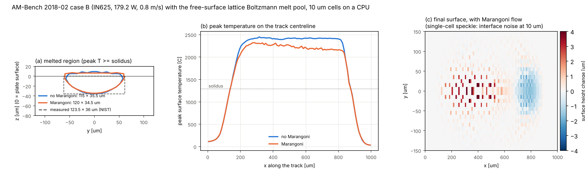

# Free-surface lattice Boltzmann melt pool (powder-scale LPBF)

`tpmsfem.process.freesurface` is our own melt-flow solver for laser powder-bed fusion. The
melt is a liquid with a moving surface; the gas above it is not simulated. It is written
against tpmsfem's array backend, so the same code runs on the CPU (NumPy) and on a GPU
(CuPy).

It is the model type of Lei et al., Cell Rep. Phys. Sci. 6 (2025) 102674 (the "HF-LBM" /
PS-MP model), whose code is not public. Status: stages 1 and 2 (bare plate, full surface
physics) are done and verified. Powder beds and multi-track GPU runs come next.

## 1. Method

**Flow** (`FreeSurfaceLBM`, lattice units).
* **Lattice and collision.** A D3Q19 lattice with two-relaxation-time collision (TRT, magic
  parameter 3/16) and Guo forcing. Liquid IN625 needs a relaxation time of about 0.504; TRT
  keeps that stable.
* **Free surface** (Koerner et al. 2005). Each cell is gas, interface, liquid or wall.
  * Interface cells carry a fill level and exchange mass with their neighbours through the
    streamed populations.
  * Populations arriving from the gas are rebuilt from the gas pressure. That pressure
    carries the Laplace pressure σκ and the recoil pressure.
  * Cells fill and empty, and the excess mass is redistributed, so mass is conserved to
    round-off.
* **Curvature.** From the smoothed fill-level field. Walls act as mirrors, which gives a
  neutral 90° contact. A height-function curvature (as in HF-LBM) is available as an option.
* **Melting and solidification.** Carman–Kozeny (Darcy) damping −C(1−f_l)²/(f_l³+b) ρu,
  applied semi-implicitly (C = 1e9 s⁻¹). Solid metal is part of the lattice and stays still
  for any C, so plate, powder and melt share one set of cells.

**Heat** (`FreeSurfaceMeltPool`, SI units).
* **Solver.** Enthalpy on the same cells: finite volume, explicit, with conduction and upwind
  advection by the melt velocity. Each cell's heat capacity is its metal mass.
* **Laser.** Absorbed below the first surface seen from above, with an exponential absorption
  depth. This is the same discretisation as the conduction model `MeltPoolModel`, so the two
  can be compared directly.
* **Surface terms.** These act on interface cells. The surface area per cell is its gas faces
  divided by |n_x| + |n_y| + |n_z|, so a flat surface gets exactly one cell of area. The
  terms are:
  * Marangoni stress (dσ/dT)∇_sT, as a continuum surface force;
  * recoil pressure 0.54 p_sat(T), from Clausius–Clapeyron;
  * evaporation cooling (Hertz–Knudsen–Langmuir, the same `Evaporation` model as the conduction
    model);
  * radiation.

**Time step.** It is set by the melt speed: Mach < 0.1. That gives 0.1–0.3 µs at 5–10 µm
cells, as in HF-LBM (0.3 µs at 6 µm).

## 2. Verification

`tests/test_freesurface.py` and `tools/lbm/compare_freesurface_track.py`.

| check | result |
|---|---|
| mass conservation (droplets, collapsing column, melt pools) | 1e-13 relative |
| Laplace pressure of a resting droplet, R = 6–10 cells | within 1 % of 2σ/R |
| spurious currents at a resting droplet | 2e-4 to 8e-4 (lattice units) |
| surface shear stress on a periodic layer → Couette profile τz/μ | within 1 % in every cell |
| Marangoni force on a flat surface | exactly dσ/dT · ∂T/∂x / dx in the surface cell, zero below |
| plate at rest, surface tension on | stays exactly at rest (u < 1e-12) |
| heat only, AM-Bench case B at 5 µm, against `MeltPoolModel` | 0.3 % RMS temperature difference; pool 290 × 110 × 30 µm vs 295 × 110 × 30 µm; energy to 1e-15 |
| energy balance with flow | round-off without surface losses or with radiation; 0.2 % with evaporation; 0.3–0.5 % with Marangoni flow (heat carried with the moving surface) |

## 3. AM-Bench 2018-02 case B with flow

`tools/lbm/freesurface_caseB.py`.
* **Case.** An IN625 plate, 179.2 W at 0.8 m/s.
* **Inputs.** The absorptivity (0.3234) and absorption depth (15.3 µm) of the calibrated
  conduction model; viscosity 5 mPa s; σ = 1.8 N/m; dσ/dT = −1.1e-4 N/(m K).
* **Grid.** 10 µm cells on 4 CPU cores, 98,000 cells, 4,700 steps of 0.2 µs, about 14 min
  per run.

| | width | depth | peak T | melt speed | surface |
|---|---|---|---|---|---|
| measured (NIST AMMT) | 123.5 ± 6.5 µm | 36.0 ± 1.9 µm | | | |
| flow without Marangoni | 115 µm | 35.5 µm | 2450 °C | 0.02 m/s | flat (±2 µm) |
| flow with Marangoni | 120 µm | 34.5 µm | 2320 °C | 0.3–0.35 m/s | ±2–6 µm |

Width and depth are interpolated at the solidus in the cross-section at 75 % of the track.



**Reading the results.**
* **Marangoni flow does what it should.** With dσ/dT < 0 the hot surface flows outwards. The
  pool widens (115 → 120 µm), gets a little shallower, and its peak temperature drops by
  130 °C.
* **Both runs fall inside the measured scatter.** This is not an independent validation,
  because the absorptivity was calibrated on the conduction model. The next step is to
  calibrate it in the flow model itself, on cases A–C together.
* **Resolution.** 10 µm cells resolve the 36 µm depth with only four cells. The surface
  shows single-cell speckle of a few µm, which is interface noise at this resolution, not
  topography. Production runs need 2.5–6 µm cells, which means a GPU.

## 4. Performance and the GPU

* **CPU.** On 4 cores with NumPy, the solver does 0.5 million cell updates per second
  (MLUPS). It is written as whole-array operations, so on a GPU the same code runs through
  CuPy unchanged.
* **GPU (estimate).** That array form should give a few hundred MLUPS on a modern GPU; this
  was not measured here. Fusing the step into a few CUDA kernels, as HF-LBM does, is worth
  several times more.
* **Grid refinement.** HF-LBM uses three grid levels: 36 µm for the layer, 12 µm per region
  and 6 µm only around the current track. That, not raw speed, is what makes thousands of
  tracks per week possible on one 12 GB TITAN V. A moving fine window is therefore the next
  structural step. With it, a single 12–24 GB GPU is enough.

## 5. Compared with HF-LBM (Lei et al. 2025)

| | HF-LBM / PS-MP | tpmsfem free surface (now) |
|---|---|---|
| flow | single-phase free-surface LBM | the same (D3Q19 TRT, Koerner) |
| heat | thermal LBM in the melt, finite differences outside | finite volume everywhere |
| curvature | height function | smoothed gradient (height function optional) |
| Marangoni, recoil, evaporation | yes | yes |
| melting / solidification | yes | Darcy damping, enthalpy |
| powder bed | built-in generator | **next** |
| grid | 3-level refinement 36 / 12 / 6 µm | uniform; **moving fine window next** |
| hardware | CUDA, one TITAN V | NumPy / CuPy; fused kernels **next** |
| microstructure | LBM-CA grains, CET | our CA grains and phase field, from the same thermal history |
| code | not released | Apache-2.0, in this repository |

## 6. Powder beds, conservative heat and calibration

**Powder generator** (`process/powder.py`, tested). It produces:
* log-normal particle sizes (median 30 µm, 15–45 µm);
* rain-and-roll packing, where each particle rolls downhill until it is held;
* a recoater cut.

Measured: packing 0.43 for a 40 µm layer and 0.50–0.52 for deep beds; no overlaps; voxelised
volume within 0.1 %.

**Solver changes for powder.**
* **Laser.** Absorbed by Beer–Lambert along the metal in each column, so light passes
  through gaps and a thin sliver of a particle takes only its share.
* **Cold powder.** Touching solid surface cells exchange no mass.
* **Stability.** A lattice speed limiter (0.25), a recoil cap (both counted), and gravity.
* **Mass.** Conserved to 1e-13 on plate and powder.

**Heat with a moving surface** (fixed). The first powder runs created energy, 5–16 %, and
particles ran away to 6,000–10,000 °C. Two causes, both fixed:

1. *Heat did not move with the mass.* The finite-volume advection uses cell velocities, while
   the free surface moves mass by its own exchange rules. With `energy_transport="lbm"` the
   enthalpy is carried with the mass itself:
   * along every lattice link, with the mass that crosses it (upwind);
   * when interface cells fill, empty or close, with the excess mass they pass on.

   A cell's new value is the mass-weighted mean of what stays and what arrives, so it never
   leaves the range of its neighbours. Only a cell that sends out more than it held cannot be
   updated exactly; that energy is booked as a residual and reported.
2. *Conduction into nearly empty cells.* With a capacity floor, a nearly empty or overdrawn
   surface cell took a different share of a face flux from its neighbour. Each face's
   conductance is now scaled by the fill of the emptier cell, and every cell changes by
   exactly the flux it exchanges over its own mass. That is conservative and stable.

| small plate, IN625, 10 µm (energy error) | finite volume | carried with the mass |
|---|---|---|
| flow, no surface driving | −2e-5 | −1e-5 |
| with Marangoni | −1.5e-3 | −1.4e-4 |
| with Marangoni and evaporation | −3.3e-3 | −7.3e-4 |

With the mass-carried transport, the energy error equals the booked residual to 1e-10
(tested). On powder at 5 µm the particles now peak near 3,500 °C (150 W, 100 µm spot) instead
of running away. The booked residual is 0.7 %, and 2.6 % for a near-keyhole 200 W, 80 µm
spot.

**Calibration on AM-Bench case B** (10 µm cells, absorption depth 5 µm instead of the
conduction model's fitted 15.3 µm). Measured: width 123.5 ± 6.5 µm, depth 36.0 ± 1.9 µm.

| Marangoni model | absorptivity | width | depth | speed limiter (cells) |
|---|---|---|---|---|
| none | 0.28 | 129 µm | 31.2 µm | 0 |
| none | 0.36 | 143 µm | 39.0 µm | 0 |
| constant −1.1e-4 N/(m K), outward | 0.32 | 136 µm | 30.5 µm | – |
| constant +1.0e-4, inward | 0.32 | 151 µm | 35.3 µm | (peak T hits the table limit) |
| Sahoo, sulfur activity 0.005 | 0.32 | 133 µm | 38.1 µm | 31 |
| Sahoo, 0.01 | 0.32 | 132 µm | 35.4 µm | 23 |
| Sahoo, 0.02 | 0.32 | 134 µm | 35.6 µm | 33 |
| Sahoo, 0.01 | 0.30 | 133 µm | 35.5 µm | 50 |
| Sahoo, 0.01 | 0.28 | 132 µm | 35.6 µm | 40 |

The first four rows predate the conservative heat step; the Sahoo and no-Marangoni rows use
`energy_transport="lbm"`.

* **No constant dσ/dT gives the measured shape.**
  * Outward flow makes the pool too shallow.
  * Inward flow overheats the centre until recoil spreads the surface.
* **Sahoo surface tension** (`SahooSurfaceTension`: Fe–S adsorption constants of Sahoo et al.
  1988 with the slope of pure nickel; dσ/dT changes sign at 1,500–1,800 °C for sulfur
  activities 0.003–0.02):
  * puts the depth on the measurement for any sulfur activity from 0.005 to 0.02;
  * leaves the width 1.3–1.6 standard deviations above it.
* **The 10 µm results are not usable for calibration yet.**
  * Without Marangoni, the pool grows with absorptivity as it should.
  * With Sahoo Marangoni, it stays at 132–133 × 35.5 µm for absorptivity 0.28–0.32, while
    the lattice speed limiter acts in 23–50 cells.
  * The Marangoni shear layer under the surface is under-resolved at 10 µm, so the limiter,
    not the physics, sets the pool size.
* **Next.** Repeat at 5 µm, which needs the faster kernels below and, for routine use, a GPU.

**Speed.** `freesurface_kernels.py` fuses the lattice step into one numba pass per cell. This
is the loop structure a CUDA kernel needs, and it is chosen automatically on the CPU. It gives
the same flags and fields as the array version to round-off (tested). The lattice step is
about 3× faster. The rest of the time step (curvature, surface terms, heat, interface
bookkeeping) is still whole-array NumPy and is now the bottleneck; moving it into kernels is
the GPU port.

## 7. Next steps

1. **Single tracks on powder vs plate** (running): balling, width and roughness.
2. **Case B at 5 µm with Sahoo surface tension**, then the absorptivity on AM-Bench cases A–C
   (predict A and C from B).
3. **Moving fine window and coarse thermal background.** Fused CUDA kernels.
4. **Height-function curvature with consistency checks.** A better curvature for powder and
   keyholes.
5. **Multi-track layers on a GPU.** For example the 20-track IN718 square of Lei et al.:
   225 W, 1.0 m/s, about 100 µm hatch.

## Reproducing

```bash
pytest -q tests/test_freesurface.py
python tools/lbm/compare_freesurface_track.py frozen      # heat only, 5 um, ~2 min
python tools/lbm/freesurface_caseB.py marangoni 10        # ~15 min on 4 cores
python tools/lbm/freesurface_caseB.py flat 10
python tools/lbm/freesurface_figure.py
```
