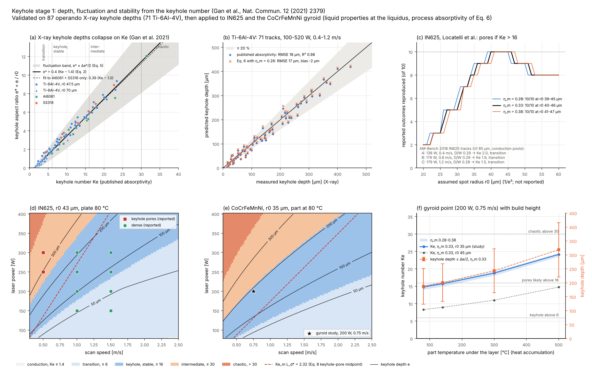
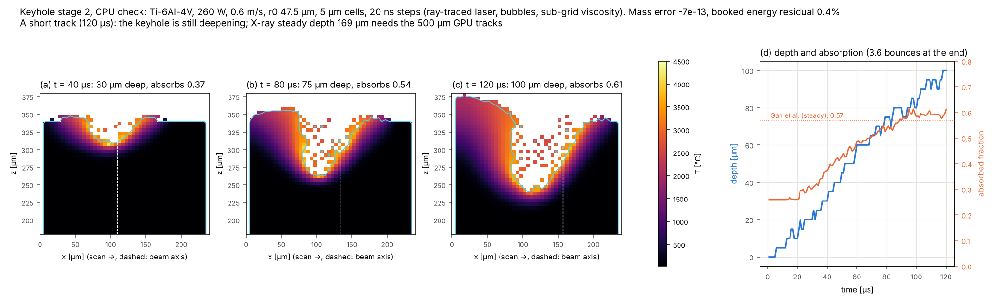
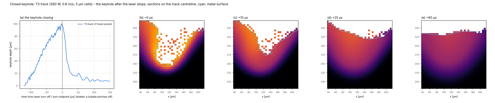
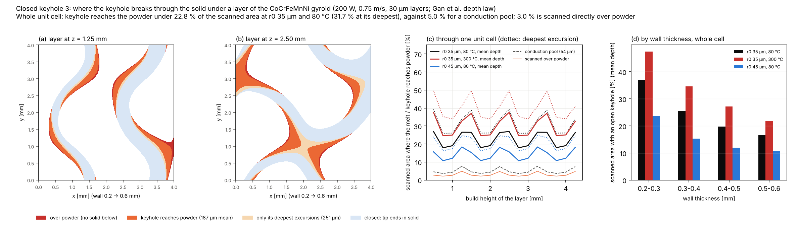
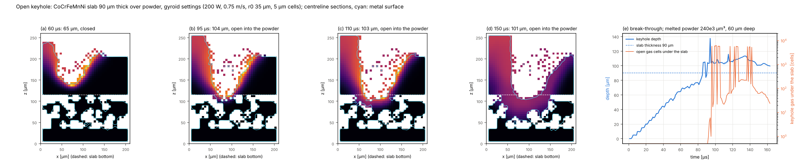

# Keyholes: depth, stability and pores

**Question.** When does the laser drill a keyhole instead of melting a shallow pool? How deep is
it, how much does it fluctuate, and when does it start trapping pores? The mechanism: local
evaporation on the front wall, a bulge, a vapour jet against the back wall, and a bubble
pinched off at the keyhole tip that the solidification front freezes in as a pore.

The work runs in two stages:
* **Stage 1 (this page, done).** Process maps from the scaling laws of Gan et al. These are
  checked against operando X-ray keyhole depths, Ti-6Al-4V first, then applied to IN625 and the
  CoCrFeMnNi gyroid.
* **Stage 2 (solver done, production runs on a GPU next).** Keyhole dynamics in the
  free-surface flow solver: ray tracing with multiple reflections, a bubble model for pores,
  and the numerics a keyhole needs. Small cases are checked on a CPU here; the X-ray cases run
  on a GPU ([Stage 2](#stage-2-keyhole-dynamics-in-the-flow-solver)).

## Stage 1: scaling laws

**Laws.** From Gan, Kafka, Parab, Zhao, Fang, Heinonen, Sun & Liu, Nat. Commun. 12 (2021) 2379
(CC BY 4.0). They are implemented in `tpmsfem.process.defects`:

| quantity | law (Gan et al.) | function |
|---|---|---|
| keyhole number | Ke = η P / ((T_l − T₀) π ρ c_p √(α v r₀³)) | `keyhole_number` |
| process absorptivity | η = 0.7 [1 − exp(−0.6 Ke_m L_d*)], Ke_m L_d* = η_m P / ((T_l − T₀) π ρ c_p v r₀²); floored at η_m | `keyhole_absorptivity`, `keyhole_porosity_number` |
| keyhole depth | e* = e / r₀ = 0.4 (Ke − 1.4), zero below 1.4 | `keyhole_aspect_ratio`, `keyhole_depth` |
| fluctuation | Δe* = 0.36 Ke^0.86 (range of e* over time) | `keyhole_fluctuation` |
| regime | conduction ≤ 1.4 < transition ≤ 6 < keyhole | `keyhole_regime` |
| stability | stable ≤ 16 (almost no pores) < intermediate ≤ 30 < chaotic (pores, spatter) | `keyhole_stability` |
| porosity | φ = 0.10 erfc(NED − 1.51) + 0.01 erf(Ke_m L_d* − 2.32) + 0.055 | `normalized_energy_density`, `gan_porosity` |
| all at once | arrays over power and speed | `keyhole_state` |

**Conventions.** The thresholds hold only with the conventions under which they were fitted:
* liquid properties at the liquidus;
* the process absorptivity of Eq. 6. It rises from the flat-melt value η_m towards 0.7 as the
  depression traps reflections.

A fixed flat-surface absorptivity puts Ke on a different scale. The paper does not state the
unit of φ in the porosity law, so only its two midpoints are used as criteria:
* NED = 1.51, for lack of fusion;
* Ke_m L_d* = 2.32, for keyhole pores.

**Script:** `benchmarks/literature/keyhole_maps.py` (seconds). **Tests:**
`tests/test_defects.py`. They check the limits, the regime edges, that the diffusivity cancels
in Ke_m L_d*, the reproduction of the data set's absorptivity column, and three X-ray depths.

## Validation on X-ray keyhole depths

**Data.** Gan et al. Supplementary Data 1, transcribed unchanged to
`benchmarks/literature/data/gan2021_keyhole_xray.json`. It holds 87 keyhole depths from
synchrotron X-ray imaging of bare plates under argon (APS 32-ID-B):
* 71 Ti-6Al-4V, the tracks of Cunningham et al., Science 363 (2019) 849: r₀ = 47.5 and 70 µm,
  100–520 W, 0.4–1.2 m/s, depths 15–445 µm;
* 9 Al6061 and 7 SS316.

**Two routes for the absorptivity.**
* *Published η.* Use the absorptivity column of the data set. This checks Ke and the depth law
  as implemented.
* *Predictive.* Compute η from Eq. 6 with the flat-melt η_m of their Supplementary Table 1:
  Ti-6Al-4V 0.26, SS316 0.33, Al6061 0.01. This is the chain applied to a new alloy:
  P, v, r₀ → η → Ke → e.

| material | n | published η: depth RMSE, bias, R² (e*) | predictive: depth RMSE, bias, R² (e*) |
|---|---|---|---|
| **Ti-6Al-4V** | 71 | **18 µm, −7 µm, 0.977** | **17 µm, −2 µm, 0.981** |
| SS316 | 7 | 25 µm, −24 µm, 0.958 | 12 µm, −1 µm, 0.991 |
| Al6061 | 9 | 23 µm, +15 µm, 0.970 | 87 µm, +80 µm, 0.59 |
| all | 87 | 20 µm, −6 µm, 0.977 | 32 µm, +7 µm, 0.925 |

**Reading the validation.**
* **Ti-6Al-4V keyhole depths are predicted to 17–18 µm RMS over 15–445 µm** (mean relative
  error 16–17 %), from the process parameters alone (panel b).
* **The law is not just a Ti-6Al-4V fit.** Fitted to the 16 Al6061 and SS316 tracks only,
  e* = 0.388 (Ke − 1.02) predicts the 71 Ti-6Al-4V depths with RMSE 18 µm (R² 0.978).
  Gan's universal 0.4 (Ke − 1.4) gives the same. Ti-6Al-4V alone gives 0.404 (Ke − 1.08)
  (panel a).
* **The regime edges hold on the data.**
  * Of the 35 tracks with Ke ≤ 6, 33 have e* ≤ 2, Gan's transition range.
  * Of the 52 tracks above 6, 51 have e* > 2.
* **The absorptivity column is Eq. 6 with a slightly different η_m.** It is reproduced exactly
  with η_m = 0.242 (Ti-6Al-4V), 0.256 (SS316) and 0.0075 (Al6061), floored at the table values.
  * Using the table values instead costs nothing for Ti-6Al-4V and SS316.
  * For Al6061 it overestimates the depth by 80 µm. With η_m near 0.01, a 33 % change moves η
    and Ke steeply.
  * Our alloys have η_m near the steels, so they are in the well-behaved range.
* **Front-wall angle, for stage 2.** tan θ = 0.77 e* + 0.49 (r = 0.988, n = 87). A flow
  solver with ray tracing has to reproduce this wall angle, not only the depth.
* **Fluctuation (Eq. 5) is not checked here.** The data set gives the time-averaged depth only.

**IN625 check on AM-Bench 2018** (bare plate, r₀ 85 µm). The measured pools have D/W =
0.28–0.29.
* With η_m = 0.33, Ke is 2.0 (A), 1.9 (B) and 1.5 (C): just past the conduction edge. With the
  85 µm spot, η stays at η_m.
* The predicted depressions are shallow: 21, 15 and 4 µm.
* This agrees with the independent calibration of the conduction model on case B: absorptivity
  0.323 and an absorption depth of 15.3 µm, the effective treatment of a shallow vapour
  depression.
* The agreement depends on η_m: 6 µm with η_m = 0.28, 25 µm with 0.38.

## IN625: Locatelli et al. (2026), with the consistent Ke

**The experiment.** Print Genius 150, 30 µm layers, 50 µm hatch, plate at 80 °C. Their text
reports:
* keyhole pores at 250 and 300 W, 0.5 m/s;
* dense parts at 150–300 W and 1.0–1.5 m/s.

The spot radius is not reported, so it is scanned from 20 to 60 µm. The pore criterion is
Ke > 16.

| η_m | outcomes reproduced (of 10) | spot radius that reproduces all |
|---|---|---|
| 0.28 | 10 | 39–45 µm |
| 0.33 | 10 | 40–46 µm |
| 0.38 | 10 | 41–47 µm |

* **All ten outcomes are reproduced for r₀ = 40–46 µm, whatever η_m** (panel c). At 43 µm:
  * the porous cases have Ke = 18.6 and 23.1;
  * the dense ones have Ke = 3.3–13.4;
  * the 1/e² diameter is 86 µm, typical of LPBF machines.
* **This supersedes the 30 µm radius of [porosity_maps.md](porosity_maps.md).** That estimate
  used a fixed absorptivity of 0.32 and properties at 700 °C, not Gan's convention. On the
  consistent scale, 30 µm reproduces only 5 of the 10 outcomes: the dense 1.0 m/s cases come
  out at Ke 17–28.
* **The porosity-law midpoint agrees.** At 43 µm, Ke_m L_d* = 2.32 reproduces 9 of 10. The miss
  is 300 W at 1.0 m/s (2.56), which is reported dense (dashed line in panel d).

## The CoCrFeMnNi gyroid

**Inputs.** The study's settings: 200 W, 0.75 m/s, r₀ 35 µm, 30 µm layers. The part
temperatures come from the heat-accumulation study ([process_models.md](process_models.md)
§7.1). η_m = 0.33 (0.28–0.38).

| part temperature | η | Ke | keyhole depth (range over time) | regime | r₀ 45 µm: Ke, depth |
|---|---|---|---|---|---|
| 80 °C (plate) | 0.62 | 14.8 (14.0–15.3) | 187 µm (124–251) | keyhole, stable | 8.3, 125 µm |
| 140 °C (~9 mm up) | 0.62 | 15.7 | 201 µm (133–268) | keyhole, stable | 9.0, 136 µm |
| 300 °C | 0.65 | 18.8 | 244 µm (165–322) | keyhole, intermediate | 11.0, 173 µm |
| 500 °C (upper bound) | 0.67 | 24.1 | 318 µm (221–416) | keyhole, intermediate | 14.8, 241 µm |

**Reading the gyroid results.**
* **The gyroid study runs in keyhole mode.** The keyhole is about 190 µm deep, six layers.
  This is at the edge of the stable range (Ke 14.8 against 16), panels e and f.
* **Heat accumulation pushes it over.** Ke crosses 16 at a part temperature of about 155 °C.
  The heat-accumulation study (about 7 °C per mm) puts this near 11 mm of build height, above
  the study's 8 mm columns. With η_m = 0.38 the crossing comes at 122 °C, about 6 mm up, so
  the top of a column would cross it. Taller builds, or a hotter part, enter the range where
  keyhole pores appear.
* **The spot size decides more than the alloy data.** With a 45 µm radius, as inferred for the
  IN625 machine, Ke stays at 8–15 up to 500 °C: stable throughout.
  * The full η_m range moves Ke by ±0.6 only.
  * Measuring the spot of the machine used is therefore the most useful single input.
* **Consequence for the earlier gyroid results.** The conduction model of §7 gave a 54 µm deep
  pool at this point. A 190 µm keyhole means a deeper, narrower pool and different
  solidification conditions at its root. The cell sizes and segregation of §7 belong to the
  upper pool, where the conduction model was validated (Piglione et al.). Stage 2 will quantify
  the root.

## Limits

* **Range of the data.** The laws were fitted to bare plates in argon with r₀ = 44–70 µm.
  * The gyroid's 35 µm spot is an extrapolation, as is the low end of the inferred IN625
    radius.
  * A powder layer shifts the absorptivity at low power. Gan et al. find the effect on the
    keyhole small once the powder melts.
* **η_m is not measured for IN625 or CoCrFeMnNi.** The SS316 value is used, with ±0.05 bounds.
* **IN625 liquid properties.** The repository table ends at 870 °C and is held constant to the
  liquidus. Ke scales as (ρ c_p k)^−1/2, so a 30 % error in that product moves Ke by 15 %.
* **Pores are inferred from thresholds,** Ke 16 and 30 and the midpoint of the porosity law,
  not simulated. The fluctuation law is taken from the paper without an independent check.
* **The IN625 check is again one data set from text.** The spot is inferred, not measured.

## Stage 2: keyhole dynamics in the flow solver

The free-surface lattice Boltzmann solver ([freesurface_lbm.md](freesurface_lbm.md)) already
had melting, Marangoni flow, recoil pressure, evaporation and radiation. Stage 2 adds what a
keyhole needs (`tpmsfem.process.keyhole`, hooks in `FreeSurfaceMeltPool`).

**Laser ray tracing** (`RayTracer`, `md.rays`).
* **Rays.** The Gaussian beam is cut into vertical rays 0.25 cells apart, out to two 1/e²
  radii; the power is renormalised exactly.
* **Marching.** Each ray marches through the once-smoothed fill-level field until it crosses
  fill = ½, located by bisection.
* **Absorption.** It deposits the Fresnel-absorbed share of its power in the metal cell half
  a cell behind the surface.
* **Reflection.** It reflects specularly about the surface normal (the fill gradient) and
  marches on, until it leaves upwards or sideways, or keeps less than 0.1 % of its power.
* **Optics.**
  * Unpolarised Fresnel absorption for a complex index n + ik.
  * n and k are chosen so that normal incidence gives the flat-melt absorptivity (Ti-6Al-4V
    0.26, Gan et al.), with k = n, the good-conductor limit behind Bramson's formula.
  * The absorptivity then peaks at 0.43 near 83° incidence.
* **Cost and update rate.** The trace runs on the host (numba, parallel over rays) in a box
  of four radii around the beam, every `ray_every` steps. A production-size trace (72,000
  rays, a keyhole 90 cells deep) takes 0.2 s on four cores.

**Bubbles** (`BubbleModel`, `md.bubbles`).
* **Regions.** Gas regions are labelled with the 18-neighbour connectivity of the D3Q19
  links. The region reaching the top of the domain is the ambient gas: the atmosphere and the
  open keyhole.
* **Pressure.** Every other region is a bubble. Its gas content is fixed when it pinches off
  (ambient pressure times its volume then), and its pressure is p_amb (V₀/V)^γ (γ = 1,
  isothermal).
* **Tracking.** Bubbles are followed between updates by their overlap:
  * merging bubbles add their gas;
  * a splitting bubble shares its gas by overlap;
  * a bubble that reopens to the ambient gas releases its gas.
* **Coupling.** The pressure difference to ambient acts on the interface cells around the
  bubble, so a bubble pinched off at the keyhole tip resists closing and can be frozen in as a
  pore.
* **GPU.** Labelling uses `cupyx.scipy.ndimage` on the GPU.

**Diagnostics** (`keyhole_metrics`):
* the depth below the original surface (first metal seen from above, within three radii of
  the beam);
* the position of the bottom;
* the front-wall angle and the opening on the track centreline;
* the bubbles with their volumes and centroids.

**Numerics a keyhole needs.** The first 5 µm checks of case T3 (260 W, 0.6 m/s) failed in
three ways. Each fix is now in the solver:
1. **Time step.** With dt = dx/(100 m/s) the recoil cap (a lattice density jump of 0.1)
   acted once the wall passed ~4,250 °C. The wall then overheated, and the speed limiter
   acted in hundreds of cells. Keyhole runs now use dt = dx/(250 m/s): lattice Mach 0.1 at
   25 m/s, and recoil pressures up to ~80 atm within the cap.
2. **Stray interface cells.** Nearly empty interface cells sprayed off the keyhole wall and
   filled the depression with a cloud of fragments. The exchange between interface cells of
   different type now runs one way only (after Thürey 2007):
   * a cell with no liquid neighbour may only lose mass;
   * a cell with no gas neighbour may only gain.

   It is clipped rather than forced, so it stays conservative and keeps the bounded heat
   transport exact. This is now the default (`lbm.interface_rules`).
3. **Bulk instability.** Liquid Ti-6Al-4V has ν = 6.8e-7 m²/s. At 20 m/s the cell Reynolds
   number u·dx/ν is ~150 at 5 µm and ~75 at 2.5 µm. The bare two-relaxation-time collision
   ran away in the melt under the keyhole: 2 → 727 cells at the speed limit in 3 µs. A shorter
   step cannot help, because this number does not depend on dt.

   A Smagorinsky sub-grid viscosity (`lbm.smagorinsky`, Cs = 0.15 for keyholes; off by
   default) raises the relaxation time where the non-equilibrium stress is large, as LBM
   melt-pool codes usually do. From the same state the bulk then stays at 10–17 m/s.

**Verification** (`tests/test_keyhole.py`, `tests/test_freesurface.py`):

| check | result |
|---|---|
| Fresnel at normal incidence | 4n/((n+1)² + k²) = A0 to 1e-12 |
| flat plate | absorbs A0 to 2e-3; deposit centred, Gaussian width within 5 % |
| inclined plane, 20° and 35° | first-hit incidence within 0.006 in cos θ (~1°); one bounce, Fresnel A(θ) |
| paraboloid keyhole, depth/rim radius 0, 2, 4.5 | absorbed 0.30 → 0.52 → 0.62, converged to 1 % in ray spacing; every watt accounted for |
| bubble in a liquid block | one bubble at ambient pressure; compressed, p = p_amb V₀/V exactly; reopened, released |
| melt pool with rays and bubbles | mass to 1e-12, energy balance = booked residual to 1e-9, flat plate 0.26 |
| numba and array (GPU) steps | agree to round-off, with and without the sub-grid viscosity |
| sub-grid viscosity | damps an unresolved 4-cell shear wave by more than half; leaves a resolved one within 3 % and a resting fluid at rest |

### CPU check: case T3 at 5 µm

**Setup.** `tools/lbm/keyhole_ti64.py T3 --dx 5e-6 --dt 2e-8 --track 72e-6 ...`. The results
are in `tools/lbm/keyhole_runs/cpu_check/`; the figure is drawn by
`tools/lbm/keyhole_figure.py check tools/lbm/keyhole_runs/cpu_check`.
* Ti-6Al-4V, 260 W, 0.6 m/s, r₀ 47.5 µm. X-ray steady depth 169 µm, Ke 10.9 (stable).
* 5 µm cells, 20 ns steps, 120 µs (72 µm of track).
* 0.16 M cells; 38 min on four CPU cores (0.42 MLUPS).

**Reading the check.**
* **A keyhole forms and deepens steadily.** On the centreline it is 30, 75 and 100 µm deep at
  40, 80 and 120 µs. It is still deepening at the end: the 169 µm steady depth needs the
  longer tracks.
* **The ray tracer gives the absorption rise of a keyhole.** The absorbed fraction goes from
  the flat-melt 0.26 to 0.37, 0.54 and 0.61 at those times, with 3.3 bounces per ray at the
  end. Gan et al.'s absorptivity for this case, from their ray-tracing model and measured
  absorptivities, is 0.57.
* **Conservation and stability.**
  * Mass error 7e-13; booked energy residual 0.4 %.
  * The speed limiter acted in 2 cells over the whole run, the recoil cap in 1.
* **Wall temperature.** It peaks at 4,300–5,300 °C, where evaporation balances the absorbed
  flux.
* **No bubbles formed.** At Ke 10.9 the keyhole is in Gan's stable range, where pores are
  rare.
* **What remains.**
  * A few isolated, less-than-half-full specks of metal float in the keyhole. They no longer
    grow, and the rays and diagnostics ignore them (they work on the fill = ½ surface).
  * 5 µm puts only 19 cells across the beam. Depth, front-wall angle and pores are judged at
    2.5 µm on the GPU.

### Production runs (GPU)

`tools/lbm/keyhole_ti64.py` runs the six X-ray cases below; `tools/lbm/run_keyhole_gpu.sh`
runs them in a row on a CUDA GPU (CuPy for the flow, numba for the rays). Each case:
* writes a diagnostics line every 1 µs and a centreline section to
  `tools/lbm/keyhole_runs/`;
* checkpoints every 20 minutes, so rerunning the same command resumes;
* is read by `tools/lbm/keyhole_figure.py`, which compares the second half of each track with
  the X-ray depth, Gan's Eq. 6 absorptivity and the measured front-wall correlation.

| case | power, speed | X-ray depth | Ke (Gan) | cells at 2.5 µm | memory (est.) |
|---|---|---|---|---|---|
| T1 | 129.4 W, 0.4 m/s | 85 µm | 5.8 | 4.5 M | 4 GB |
| T2 | 209.3 W, 1.1 m/s | 79 µm | 4.2 | 4.5 M | 4 GB |
| T3 | 260.2 W, 0.6 m/s | 169 µm | 10.9 | 5.7 M | 5 GB |
| T4 | 312.5 W, 0.9 m/s | 172 µm | 9.8 | 5.8 M | 5 GB |
| T5 | 364.8 W, 0.7 m/s | 257 µm | 15.1 | 7.7 M | 7 GB |
| T6 | 468.0 W, 0.7 m/s | 351 µm | 20.7 | 9.8 M | 9 GB |

All cases use r₀ = 47.5 µm, a 500 µm track and 100 µs of cooling, dt = 10 ns at 2.5 µm: 55,000–135,000 steps.
T5 and T6 straddle the Ke 16 pore threshold: the bubble model should start trapping pores
there.

**Next after the Ti-6Al-4V validation:** IN625 and the CoCrFeMnNi gyroid at 80 and 300 °C.

## Closed keyholes

A keyhole closes, or opens, in three ways:
1. **It collapses where the laser stops or turns.** This is the end of a track, or a turn
   point.
2. **It collapses while scanning.** An unstable keyhole pinches off bubbles at its tip.
3. **It opens through the part.** In welding terms an LPBF keyhole is "closed" (blind): its
   tip ends in metal. Under a thin, down-facing wall it can reach through into the powder
   below and become "open" (full penetration).

### Why this matters for TPMS lattices

| scan of one layer | hatch vectors | mean vector length | track ends per mm² |
|---|---|---|---|
| CoCrFeMnNi gyroid, 4 heights | 56–95 | 0.33–0.52 mm | 28–44 |
| solid 4 × 4 mm block | 45 | 3.8 mm | 5.7 |

The study's settings are 85 µm hatch, one contour, 0.75 m/s.
* **The lattice has 5–8 times more track ends per area than a solid block.**
* **Most of a gyroid track lies near an end.** Martin et al. found nearly all turn-point pores
  within 200 µm of the turn (below), and the gyroid's vectors are only 0.33–0.52 mm long.

### 1. Closure where the laser stops or turns

**Data.** Martin, Calta, Khairallah et al., Nat. Commun. 10 (2019) 1987, open access.
* **Setup.** Ti-6Al-4V, 50 µm beam, 50–300 W, 0.6–1.0 m/s, single-turn scans with 50 µm
  hatch, imaged by X-ray at 20 kHz.
* **The turn.** The galvanometer mirrors decelerate about 900 µs before the turn and are back
  at speed about 1,200 µs after it. The slow beam overheats the turn: the depression deepens
  (at 50 W, 1 m/s from 32 to 62 µm) and peaks about 100 µs after the turn.
* **The collapse.** As the beam accelerates away, the deep depression collapses and leaves
  argon pores:
  * 87 % of the pores lie within 200 µm of the turn;
  * they formed 200–1,000 µs after it;
  * pores formed at every power.
* **Turn-off.** Switching the laser off at a track end (skywriting) collapses the keyhole the
  same way.
* **The fix.** A power schedule that keeps the depression depth even (100 W, 1 m/s) left no
  pores.

**Tools** (`tools/lbm/keyhole_ti64.py --scenario ...`, `tpmsfem.process.scanpath`):

| scenario | what | builds on |
|---|---|---|
| `track` | straight track, laser off abruptly at the end, the closing keyhole followed for `--cool` | |
| `ramp` | power ramped linearly to zero over the last `--ramp` of the track | `ramp_down` |
| `turn` | galvanometer turn: deceleration 1.1e3 m/s², hatch shift, back at speed; constant power | `turn_point` |
| `turn-ke` | the same turn with the power cut as the beam slows, keeping Gan's keyhole number of the steady track (floor 20 %) | `defects.keyhole_power` |

* **Pores.** The bubble model marks a bubble `frozen` when all the metal around it is below
  the solidus: a pore trapped by solidification.
* **Diagnostics.** After the laser stops, they follow the keyhole where the beam left it.
* **Martin's cases.** M100, M200 and M300 (W, at 1.0 m/s, r₀ 25 µm) run the turn on a 400 µm
  plate: 6.2 M cells at 2.5 µm, 2.7 M at 3.33 µm, 2.1 ms of scanning.
* **Mitigation.** For M200 the constant-Ke schedule lowers the power from 200 W to about
  69 W at the reversal.

**CPU check: abrupt turn-off**
* **Setup.** Case T3 (Ti-6Al-4V, 260 W, 0.6 m/s), 5 µm cells, 120 µs of track, then 150 µs
  with the laser off.
* **Files.** `tools/lbm/keyhole_runs/cpu_check_off/`; figure by
  `tools/lbm/keyhole_figure.py closure`.

* **The keyhole closes in about 30 µs.**
  * At turn-off it is 100 µm deep, with a mouth about 90 µm wide.
  * Then: 89 µm at +5 µs, 66 at +11, 32 at +20, 19 at +29.
  * After that a 7–8 µm crater remains and freezes.
  * This is the capillary closing time √(ρR³/σ) ≈ 15 µs for a 45 µm radius, within a factor
    of two.
* **No pore.** The walls and the bottom refill together; no gas is cut off. Mass is conserved
  to 2e-12, and the booked energy residual is 0.6 %.
* **Why no pore here.** Pores need a deep, narrow keyhole whose walls meet above a gas pocket
  before the bottom fills: the deep-keyhole collapse Martin et al. describe. This short track
  stopped at half its steady depth (aspect ratio ~1 to its mouth).
* **The decisive cases run on the GPU.**
  * T3 at its steady depth (169 µm, aspect 3.6) after a 300 µm track, abrupt and ramped.
  * Martin's turns: the turn drives the keyhole into the deep regime.
  * The prediction: abrupt turn-off and constant-power turns trap pores, the ramp and the
    constant-Ke turn do not.

### 2. Collapse while scanning

* **Which runs.** In the steady X-ray cases, T5 (Ke 15) and T6 (Ke 21) straddle Gan's pore
  threshold, Ke ≈ 16.
* **What is recorded.** The run log records every bubble: when it pinches off, its size, its
  depth, and whether it freezes in.
* **What is compared.** `tools/lbm/keyhole_figure.py` reports bubbles formed, released and
  frozen per run, to compare with the Ke 16 and 30 thresholds. Pores per millimetre of track
  against Ke is the stage-1 prediction made dynamic.
* **No CPU check.** At 5 µm a Ke above 16 keyhole is not resolved: its tip is a few cells
  wide.

### 3. Open or closed: the keyhole under a down-facing wall

**Map** (`benchmarks/literature/keyhole_penetration.py`, about 2 min).
* **Setup.** The graded gyroid of the study (4 mm cell, walls 0.2 → 0.6 mm) is sliced into
  30 µm layers at 16 heights through one unit cell.
* **Solid below.** For every scanned point, the solid below the layer is the distance down to
  the first point outside the sheet (5 µm steps).
* **Break-through criterion.** The keyhole reaches the powder where its depth below the powder
  top exceeds the layer plus that solid. The depth is Gan's mean, or its deepest excursion
  (mean + r₀Δe*/2).

| settings | Ke | keyhole depth (deepest) | scanned area where the keyhole reaches powder (deepest) |
|---|---|---|---|
| r₀ 35 µm, part 80 °C (study) | 14.8 | 187 µm (251) | **22.8 %** (31.7 %) |
| r₀ 35 µm, 300 °C | 18.8 | 244 µm (322) | 30.4 % (40.5 %) |
| r₀ 45 µm, 80 °C | 8.3 | 125 µm (175) | 14.2 % (20.8 %) |
| r₀ 45 µm, 300 °C | 11.0 | 173 µm (237) | 20.8 % (29.8 %) |
| conduction pool, 54 µm (§7) | | | 5.0 % |
| scanned directly over powder | | | 3.0 % |

* **Area affected.** At the study settings the keyhole opens into the powder under nearly a
  quarter of every layer, and under a third at its deepest. A conduction pool would reach the
  powder under 5 %. These are the down-facing sides of the walls (orange in panels a, b).
  The share swings between 18 and 27 % with height.
* **Thin walls are worst.** At r₀ 35 µm and 80 °C the share is:

  | wall | share (mean depth) | share (deepest excursion) |
  |---|---|---|
  | 0.2–0.3 mm | 37 % | 50 % |
  | 0.3–0.4 mm | 26 % | 36 % |
  | 0.4–0.5 mm | 20 % | 28 % |
  | 0.5–0.6 mm | 17 % | 23 % |

* **Heat accumulation and spot size move it.** A hotter part (300 °C) raises the share to 30 %.
  The larger 45 µm spot lowers it to 14 %.
* **What an open keyhole does.** It melts into the powder (dross, sagging of down-skin
  surfaces), and its gas connects to the powder bed. The flow case below checks what happens
  at the break-through.

**Flow case** (`tools/lbm/keyhole_overhang.py`).
* **Geometry.** A CoCrFeMnNi slab over a rained powder bed (120 µm, d50 30 µm) on a 30 µm base
  plate.
* **Scan.** 200 W, 0.75 m/s, r₀ 35 µm on the bare slab top.
* **Physics** as in the Ti-6Al-4V runs, with assumed Fe–Ni–Cr-type melt properties: σ 1.8 N/m,
  dσ/dT −1.1e-4 N/(m K), μ 5 mPa s. Recoil and evaporation are those of Mn at 20 at%, as in the
  gyroid study.
* **Gas in the powder.** It is open to the chamber through the bed (gas reaching the side faces
  is ambient), so only pockets enclosed by the melt count as bubbles.
* **Outputs.**
  * the break-through (`open_below`: the keyhole's gas reaches under the slab);
  * the pores and whether they freeze in;
  * the powder melted under the slab (dross volume and depth).
* **Cases.** Slabs of 90, 150 and 250 µm bracket open, intermittent and closed: 3–4 M cells at
  2.5 µm, 400 µs of scanning.

**CPU check: a 90 µm slab**
* **Setup.** 5 µm cells, a 100 µm track, 80 µm of powder (101 particles, packing 0.46);
  20 min on four cores.
* **Files.** `tools/lbm/keyhole_runs/cpu_check_overhang/`; figure by
  `tools/lbm/keyhole_figure.py overhang`.

* **The keyhole breaks through.** It deepens inside the slab, closed, until it passes the
  slab's underside at 92 µs (103 µm deep). Its gas then joins the gas of the powder bed.
* **It stays open, but unsteadily.** The connection flickers between tens and ~10⁴ gas cells,
  as melt runs into the powder and seals it again. The keyhole is held at 100–110 µm, with
  spikes to 137 µm.
* **Dross.** Melt sags into the powder below the slab: 240,000 µm³ of melted powder, reaching
  60 µm down, under a 100 µm track.
* **Conservation and pores.** Mass to 7e-13; booked energy residual 0.4 %. No pore froze in:
  sealed voids between cold particles are not counted, only bubbles whose walls were molten
  (`pore`).
* **Agreement with the map.** It predicted break-through where the keyhole (mean 187 µm by
  Gan's law) exceeds the solid below. Here the keyhole never reached its free depth: the slab
  bottom stopped it, and the melt went into the powder instead.
