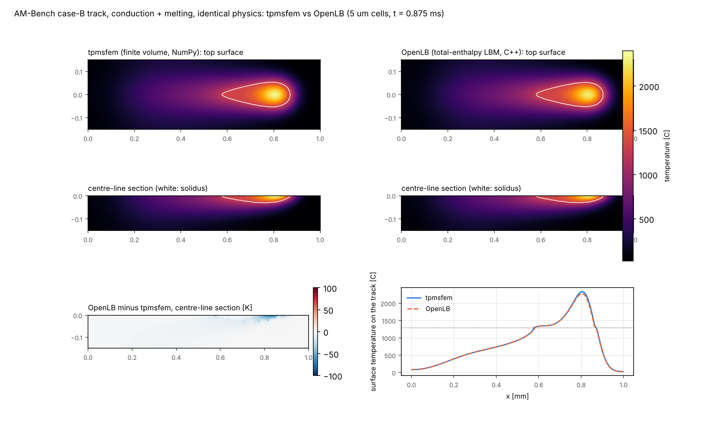

# Feasibility check: coupling tpmsfem to a lattice Boltzmann melt-pool code

**Question.** Can an open-source lattice Boltzmann (LBM) code resolve the melt pool, and later
the powder bed, of laser powder-bed fusion for tpmsfem? Is it worth coupling?

**Short answer.**
* **The codes build and run here, and the numerics agree.** Both waLBerla and OpenLB build on
  this 4-core CPU. Given the same physics (conduction and melting) on the AM-Bench case-B
  track, OpenLB reproduces tpmsfem's melt-pool model to 1.3 % RMS in temperature.
* **The laser-melting physics is not there yet.** Neither code ships it. The free-surface flow,
  Marangoni, recoil, evaporation and laser coupling would have to be built.
* **A melt-flow track needs a GPU.** On this CPU one such track would take about 10–30 hours.
* **Couple through files.** Both codes are GPL, so they should exchange files with tpmsfem
  (Apache-2.0) rather than be linked into it.

Checked on 2026-11-12 with waLBerla master (`dc16f31`, 2026-08-04) and OpenLB 1.9r0
(`4b911c3`).

## 1. What the two codes offer for laser melting

| capability | waLBerla (GPLv3) | OpenLB 1.9 (GPLv2 or later) |
|---|---|---|
| free-surface flow (volume of fluid, surface tension, wetting) | yes (`lbm/free_surface`, showcases) | yes (`examples/freeSurface`) |
| heat transfer | yes (separate showcases) | yes |
| melting and solidification | no | yes: total-enthalpy model (Huang & Wu 2015) coupled to flow through a partially saturated porous medium (Stefan, gallium-melting examples) |
| Marangoni (temperature-dependent surface tension) | two-phase phase field (`Thermocapillary`, needs the lbmpy code generator), not free surface | no |
| laser heat source, evaporation, recoil pressure | no | no |
| free surface coupled to heat and melting | no | no |
| powder particles | packing (`mesa_pd`, `ParticlePacking`) | particle modules |
| GPU | yes (code generation) | yes (CUDA, HIP, SYCL) |

Neither code has a laser powder-bed fusion application. The closest base is OpenLB: it already
couples melting to flow, and it has a separate free-surface module. What is missing in both:
* the free surface coupled to heat transfer and melting;
* Marangoni stress on the free surface;
* recoil pressure and evaporation losses;
* laser absorption at the moving surface;
* a spread powder bed.

## 2. Measured here (4 CPU cores, no GPU)

| run | lattice | throughput |
|---|---|---|
| OpenLB, Stefan melting (2-D, shipped example) | heat + melting | 16 MLUPS; temperature error 0.5 %, melt-fraction error 2.6 % (L2, relative) against the analytic solution |
| OpenLB, case-B track, conduction + melting (this check) | D3Q7, 0.36 M cells | 86 MLUPS |
| OpenLB, breaking dam (3-D free surface, shipped example) | D3Q19, 0.42 M cells | about 4 MLUPS |
| waLBerla, drop wetting (3-D free surface with wetting) | D3Q19, 1.15 M cells | about 8 MLUPS |
| tpmsfem `MeltPoolModel` on the same case-B track | finite volume, NumPy | 11 M cell updates per second |

MLUPS: million lattice-cell updates per second.

## 3. Case-B track with identical physics

`tools/lbm/openlb_lpbfTrack3d/lpbfTrack3d.cpp` runs the AM-Bench case-B track in OpenLB as
conduction plus melting. It uses:
* OpenLB's total-enthalpy model, with a volumetric laser source added to the collision;
* the calibrated case-B laser: 179.2 W, absorptivity 0.3234, 1/e² radius 85 µm, absorption
  depth 15.3 µm, 0.8 m/s;
* IN625-like constant properties: k = 25 W/(m K), cp = 650 J/(kg K), 8440 kg/m³, latent heat
  2.72e5 J/kg, solidus 1290 °C, liquidus 1350 °C;
* a 1.0 × 0.3 × 0.15 mm block, 5 µm cells, adiabatic walls, no surface losses.

`tools/lbm/compare_openlb_track.py` runs tpmsfem's `MeltPoolModel` on the same problem and
compares the temperature fields at the end of the track (0.875 ms).

| | tpmsfem | OpenLB |
|---|---|---|
| melt pool (solidus) length × width × depth | 295 × 110 × 30 µm | 290 × 100 × 30 µm |
| peak temperature | 2329 °C | 2272 °C |
| temperature difference where above 500 °C | | 10 K RMS (1.3 %), 86 K maximum |
| energy held | | 1.2 % less |
| run time | 34 s | 5.6 s |



**Reading the results.**
* **The two solvers agree.** The width differs by two 5 µm cells. The 1.2 % energy difference
  is the first-order source term added to OpenLB's collision.
* **A one-cell offset in the coupling made a 10 % error.** The first attempt placed OpenLB's
  nodes on the cell faces of the tpmsfem grid instead of the cell centres. The domain grew by
  one node per direction, the source started at depth 0 instead of 2.5 µm, and OpenLB held
  10 % more energy with a 20 % longer pool. A coupling has to map the grids exactly.
* **Our solver is the slower one here.** On the same physics, OpenLB's C++ is 6× faster than
  the NumPy melt-pool solver. A fused numba kernel, as written for the phase field, would
  close most of that gap.

## 4. Cost of a free-surface case-B track

AM-Bench 2018-02 tracks are on a bare plate, so case B needs no powder. It does need the flow:
Marangoni convection and the vapour depression under the beam.

**Estimate.**
* **Domain.** 1.0 × 0.3 × 0.2 mm, including gas above the surface.
* **Cells.** 2–2.5 µm cells, so 3.8–7.5 M cells.
* **Time step.** It is set by the liquid viscosity (about 5–7 mPa s for liquid nickel alloys)
  at a relaxation time of 0.51, and stays below Mach 0.1 at 10 m/s melt velocities. That gives
  15–23 ns, about 45,000–65,000 steps for 1 ms.
* **Work.** 1.7e11–5e11 cell updates per track.
* **This CPU.** At 4–8 MLUPS (the free-surface rates above, before any heat coupling) that is
  about 10–30 hours per track.
* **On a GPU.** Single GPUs are reported to reach hundreds of MLUPS on free-surface LBM; this
  was not measured here. That would bring a track to minutes, or tens of minutes.
* **Powder.** A powder-resolved track needs 1–2 µm cells over particles of about 15–45 µm and
  a powder generator, which multiplies the cost again.

## 5. Licences

waLBerla is GPLv3 and OpenLB is GPLv2-or-later. tpmsfem is Apache-2.0.
* **Linking.** Linking either code into tpmsfem would make the combined program GPL.
* **File coupling.** Exchanging files between separate programs keeps the licences apart, as
  here.
* **This check.** The OpenLB application in `tools/lbm/openlb_lpbfTrack3d/` adapts OpenLB code
  and is marked GPL-2.0-or-later. The comparison script is ordinary tpmsfem code.

This is a practical note, not legal advice.

## 6. Recommendation

1. **If we go ahead, build on OpenLB.** It already couples melting and flow, it has a
   free-surface module, and it runs on GPUs. The new physics, in order:
   * the free surface carrying the heat-transfer and melting lattice;
   * Marangoni stress at the interface;
   * recoil pressure and evaporation losses (Clausius–Clapeyron, as in tpmsfem);
   * laser absorption at interface cells.

   That is several months of work for someone fluent in OpenLB's template-heavy C++. Validate
   first on AM-Bench case B (bare plate), where tpmsfem's conduction model already matches
   width and depth.
2. **Couple offline, through files.** The LBM code runs a few tracks per regime: power, speed,
   wall thickness and overhang. tpmsfem takes calibrated parameters back:
   * absorptivity and absorption depth;
   * an effective liquid-conductivity factor for Marangoni flow;
   * porosity and adhered-powder statistics.
3. **Budget a GPU.** Free-surface tracks are impractical on this CPU.
4. **Speed up our own melt-pool solver first.** A numba kernel is cheap and helps every
   existing study.

## Reproducing

```bash
git clone --depth 1 https://gitlab.com/openlb/release.git openlb   # OpenLB 1.9
# config.mk: CXX := g++, PARALLEL_MODE := OMP, PLATFORMS := CPU_SISD (see section 2)
cp -r tools/lbm/openlb_lpbfTrack3d openlb/examples/thermal/lpbfTrack3d
make -C openlb/examples/thermal/lpbfTrack3d
(cd openlb/examples/thermal/lpbfTrack3d && OMP_NUM_THREADS=4 ./lpbfTrack3d 5)      # 6 s
python tools/lbm/compare_openlb_track.py openlb/examples/thermal/lpbfTrack3d/enthalpy.bin 5
```
