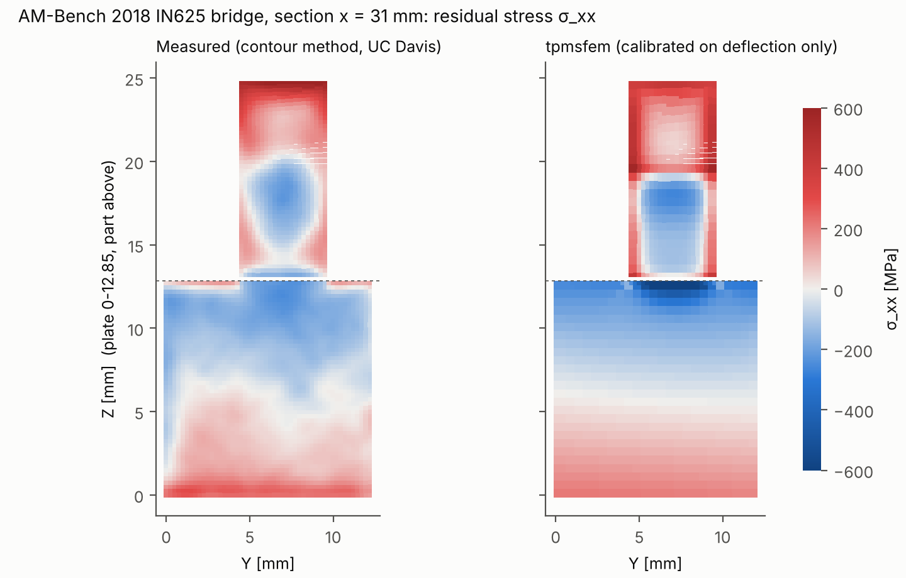
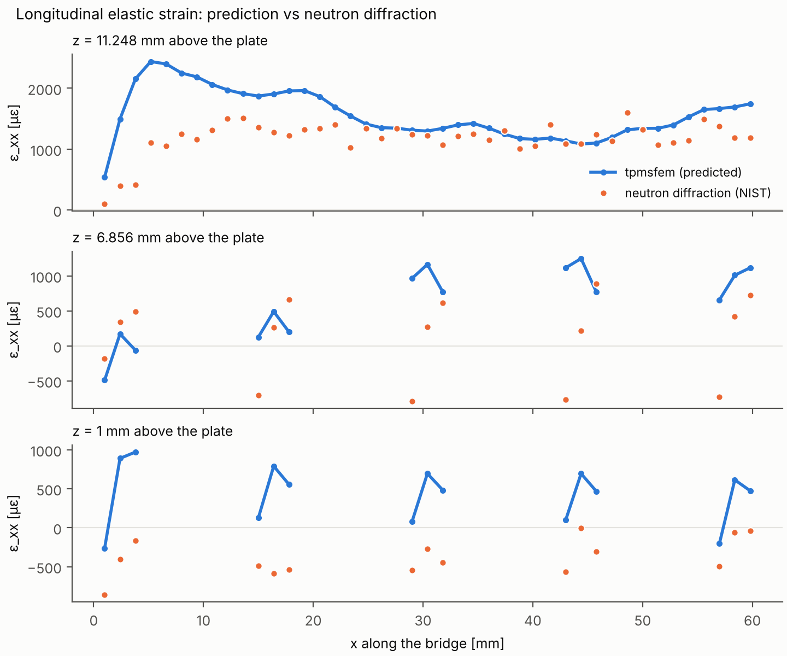
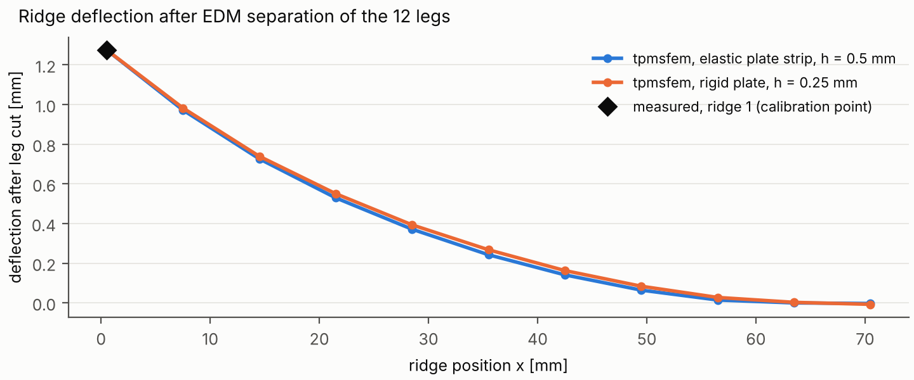
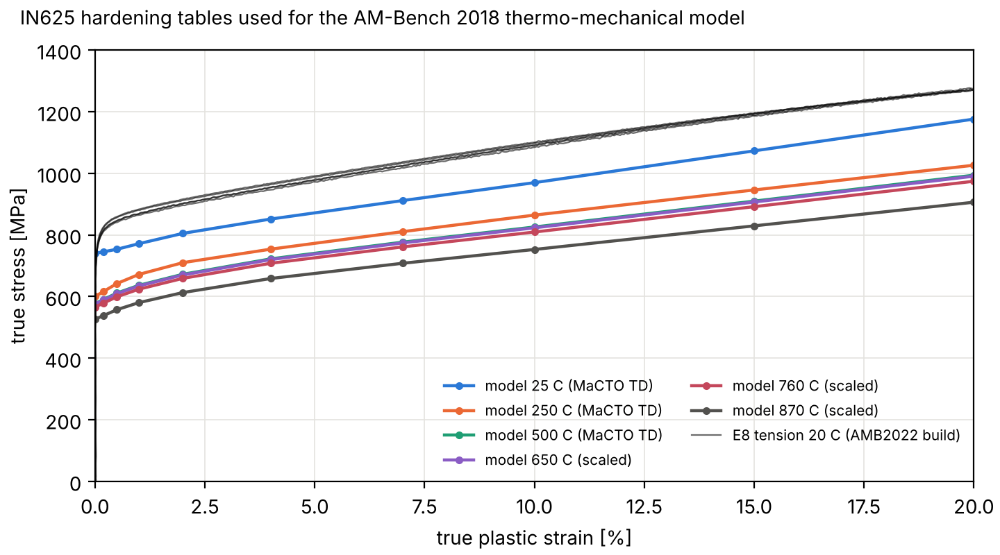
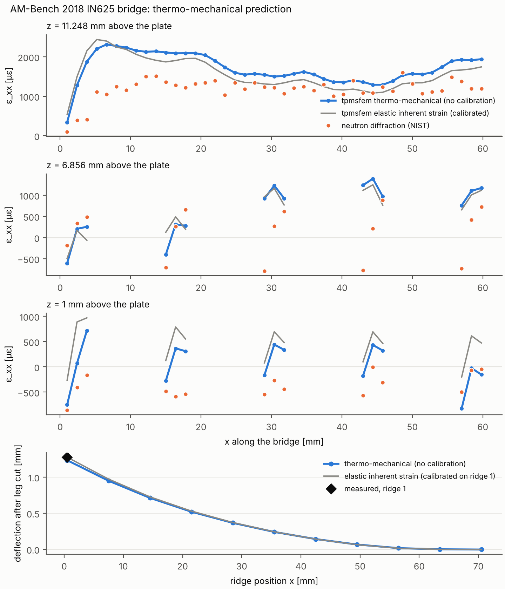

# Benchmarks against published results

This page compares tpmsfem with results published by four independent groups:

* the Khalifa University groups of **Imad Barsoum** and **Marwan El-Rich** (§1, §2);
* the **NIST AM-Bench 2018** residual-stress benchmark (§3);
* **Chaozong Liu's group at UCL** (Ti6Al4V scaffolds, §4).

 Every published
number below is transcribed from the paper, with its location; the transcriptions
are in `benchmarks/literature/data/*.json`. Every tpmsfem number is reproduced by
`benchmarks/literature/run_all.sh`. Raw results are written to `results/literature/`.

These are **independent re-implementations from the paper text**, unlike the CalculiX
comparison, which uses identical decks and agrees to 1e-7. They use:

* a different element type (voxel hex8, vs. Abaqus C3D10 and Ansys tets);
* our own geometry generation;
* our reading of every detail the paper does not state. Each such assumption is listed.

**Numerical uncertainty.** Each tpmsfem value comes from three voxel grids:

* If the three values converge, the value is Richardson-extrapolated. Its uncertainty is
  the grid-convergence index (GCI; Celik et al., *J. Fluids Eng.* 130 (2008) 078001,
  generalised for non-constant refinement ratios).
* If they oscillate, or the changes do not shrink with refinement, the finest value is
  reported. Its uncertainty is the spread of the three.

Voxelisation shifts the volume fraction by a few tenths of a percent between grids. For the
Barsoum lattices, which have a target density, each grid value is therefore scaled back to
the target density with the topology's own Gibson–Ashby exponent before extrapolation.

## Summary

| paper | quantity | agreement |
|---|---|---|
| Van Viet, Zaki & **El-Rich** 2025 | E_y of graded gyroid femur and cranial cells (all 4 values stated in the text) | **−1.1 % … +3.2 %** |
| Ahmed, **Barsoum** & Abu Al-Rub 2022 | periodic-cell E vs. the literature fits their Table 3 lists (Lee et al.; Al-Ketan et al.) | IWP-S **−8 … +0.3 %**, IWP-L **−5 … +5 %**, P-S **−12 … −4 %**; G-S +20 … +48 % against an *experimental* reference |
| Ahmed, Barsoum & Abu Al-Rub 2022 | 3×3×3 specimen E vs. their Ansys Table 3 fits | our elastic moduli are higher: +14 … +40 % (P-S), +41 … +70 % (IWP-S), +32 … +37 % (IWP-L), +81 … +100 % (G-S). For P-S and IWP-S the paper's values equal our elastic-plastic secant modulus at 0.7–0.9 % strain (§2.3) |
| Ahmed, Barsoum & Abu Al-Rub 2022 | modulus reduction by SLM residual stress | effect and magnitude (5–17 %) reproduced; **topology ranking not reproduced** with a uniform inherent strain (§2.4) |
| **NIST AM-Bench 2018** (IN625 LPBF bridge; NIST, UC Davis, LLNL, Cornell) | residual stress/strain **measured** by contour method, neutron and synchrotron diffraction, and the deflection after the leg cut | **thermo-mechanical model, no calibration:** deflection **−3.3 %** with MaCTO compression of the same build, **+8.5 %** with AMB2022 E8 tension (−40 % with a generic DED table); contour σ_xx r = 0.71 (part) / 0.87 (plate); synchrotron ε_xx r = 0.80, ε_zz r = 0.92; neutron ε_xx r = 0.88 in the body, 0.22 in the legs (bias +265 → −49 µε) (§3.1). Elastic inherent strain calibrated on the deflection: r = 0.77 / 0.85, 0.75 / 0.89, 0.81 / 0.13 (§3) |
| Naghavi, …, **Liu** (UCL) 2022 | compressive modulus of Ti6Al4V sheet gyroid/diamond bone scaffolds (6 designs), vs their Abaqus FE and experiments | **−15 … −21 %** vs their FE across all six designs (a near-constant factor of 1.23 ± 0.03); relative trends within ±4 %; −10 … −20 % vs experiments (§4) |

---

## 1. Van Viet, Zaki & El-Rich, PLoS One 20 (2025) e0332104

*"Tuneable multidirectional mechanical attributes of novel sectionally nonlinearly
functionally graded femur and cranial bone implants with triply periodic minimal
surfaces"*, doi:10.1371/journal.pone.0332104, open access (PMC12419660).

**What they did.** These are single gyroid cells whose sheet-thickness parameter `t` is
graded along z:
* Cranial cell (Eq. 1): thick at both ends, thin in the middle.
* Femur cell (Eq. 2): trabecular grading in the lower half, cortical in the upper half.
* Thickness limits from Table 1: t_max = 1.5, t_min = 0.2, t_minc = t_maxt = 0.5.

The material is Ti with E = 104 GPa and ν = 0.3. They used Abaqus C3D10 elements, about
45,000 per cell, and homogenised with periodic boundary conditions. For loading along x or y,
the faces normal to z are traction-free.

**What we did.** Same cells, voxel hex8 at 40/60/90 voxels per cell. We used
`tpmsfem.fem.homogenize` with periodicity in x and y, free z faces, and in-plane loading
(ε_xx, ε_yy, γ_xy), giving E_y = 1/S_yy.

**Assumptions (not stated in the paper):**
* One gyroid period per cell, with the gyroid phase starting at z = 0.
* Sheet solid where |f| ≤ t(z). This is consistent with Table 1: t_max equals max|f| of each
  surface (1.5 for gyroid, 3 for primitive, 5 for IWP), i.e. the "fully dense" end.

| case | vol. fraction | E_y on 3 grids (n=40/60/90) [GPa] | E_y best [GPa] | uncertainty | published [GPa] | diff |
|---|---:|---|---:|---:|---:|---:|
| cranial g0=2 | 0.417 | 25.72 / 25.78 / 25.83 | 26.11 | GCI 1.3 % | 25.3 | +3.2 % |
| cranial g0=3 | 0.348 | 20.13 / 19.62 / 19.69 | 19.69 | spread 2.6 % | - | - |
| cranial g0=4 | 0.307 | 15.69 / 16.57 / 16.35 | 16.35 | spread 5.4 % | - | - |
| cranial g0=5 | 0.280 | 13.58 / 14.14 / 14.28 | 14.34 | GCI 0.5 % | - | - |
| cranial g0=7 | 0.245 | 10.92 / 11.03 / 11.57 | 11.57 | spread 5.6 % | 11.5 | +0.6 % |
| femur gc=0.5 gt=2 | 0.486 | 34.78 / 34.68 / 34.85 | 34.85 | spread 0.5 % | 35.2 | -1.0 % |
| femur gc=1 gt=2 | 0.428 | 27.21 / 27.48 / 27.53 | 27.54 | GCI 0.1 % | - | - |
| femur gc=3 gt=2 | 0.343 | 18.04 / 17.94 / 17.99 | 17.99 | spread 0.6 % | - | - |
| femur gc=7 gt=2 | 0.304 | 13.29 / 13.76 / 13.84 | 13.85 | GCI 0.1 % | 14.0 | -1.1 % |

All four values stated in the text are reproduced within −1.1 % to +3.2 %. That is well
inside the paper's own experiment-vs-FE scatter (up to 15.6 %) and comparable to its
homogenisation-vs-reaction-force check (0.1 %) plus the voxel-vs-C3D10 discretisation
difference. Stiffness falls with the gradient index as the paper describes. E_x and E_y
differ by 2–6 % because the gyroid phase breaks x/y equivalence in a z-graded cell; the
paper reports y.

Not reproduced: Table 2 (cortical part of the femur cell). The paper does not define how
the cortical part was isolated or which axis is "longitudinal". The wave-velocity and Hill
yield-surface results need the Ti plasticity data of their ref. 46, which the paper does not
list.

---

## 2. Ahmed, Barsoum & Abu Al-Rub, Metals 12 (2022) 1344

*"Numerical investigation on the effect of residual stresses on the effective mechanical
properties of 3D-printed TPMS lattices"*, doi:10.3390/met12081344, CC BY.

**What they did.**
* **Lattices:** IN718 (Table 1: E0 = 165 GPa, ν = 0.3, σ_y = 648 MPa). Four types: P-S, G-S
  and IWP-S sheets, and the IWP-L ligament lattice. Relative densities 10, 20 and 30 %, as
  3 × 3 × 3 cells of 10 mm.
* **Process simulation:** sequentially coupled thermo-mechanical SLM simulation in Ansys
  Workbench (HEX8, 0.4 mm lumped layers), followed by plate removal.
* **Mechanical test:** compression and tension along z on 0.25 mm tets, with a bilinear
  elastic-plastic material. The bottom face has a z-symmetry condition. The top is driven
  through a remote point to ±10 % strain.
* **Modulus:** slope of the elastic part of the stress–strain curve, giving the Gibson–Ashby
  fits of Table 3. The same table also lists periodic-cell literature fits.

**Our models.**
* Voxel hex8, density-calibrated level sets.
* IWP-L is the f > c side of the I-WP surface. That is the body-centred "I" labyrinth
  (ligaments along ⟨111⟩), chosen *a priori* because the paper calls it bending-dominated
  (n ≈ 2.4).
* P-S, IWP-S and IWP-L are mirror-symmetric about the specimen mid-planes and run as quarter
  models. The chiral gyroid runs as a full model.

### 2.1 Periodic unit cell vs. the literature rows of Table 3

| topology | rho | E/E0 on 3 grids (density-corrected) | E/E0 best | uncertainty | published | diff |
|---|---:|---|---:|---:|---:|---:|
| P-S | 0.10 | 0.0148 / 0.0155 / 0.0157 | 0.0158 | GCI 0.4 % | 0.0164 | -4.0 % |
| P-S | 0.20 | 0.0417 / 0.0421 / 0.0430 | 0.0430 | spread 3.0 % | 0.0487 | -11.7 % |
| P-S | 0.30 | 0.0878 / 0.0852 / 0.0862 | 0.0862 | spread 3.0 % | 0.0921 | -6.5 % |
| G-S | 0.10 | 0.0311 / 0.0308 / 0.0315 | 0.0315 | spread 2.2 % | 0.0213 | +48.1 % |
| G-S | 0.20 | 0.0672 / 0.0693 / 0.0697 | 0.0697 | GCI 0.1 % | 0.0553 | +26.0 % |
| G-S | 0.30 | 0.1161 / 0.1139 / 0.1162 | 0.1162 | spread 2.0 % | 0.0968 | +20.0 % |
| IWP-S | 0.10 | 0.0250 / 0.0262 / 0.0262 | 0.0262 | GCI 0.0 % | 0.0262 | +0.3 % |
| IWP-S | 0.20 | 0.0727 / 0.0718 / 0.0710 | 0.0672 | GCI 6.8 % | 0.0730 | -8.0 % |
| IWP-S | 0.30 | 0.1289 / 0.1322 / 0.1319 | 0.1319 | spread 2.5 % | 0.1330 | -0.8 % |
| IWP-L | 0.10 | 0.0027 / 0.0028 / 0.0029 | 0.0031 | GCI 6.7 % | 0.0029 | +5.0 % |
| IWP-L | 0.20 | 0.0172 / 0.0173 / 0.0179 | 0.0179 | spread 3.9 % | 0.0183 | -2.2 % |
| IWP-L | 0.30 | 0.0497 / 0.0501 / 0.0506 | 0.0506 | spread 1.8 % | 0.0533 | -5.0 % |

| topology | C1 (ours) | n (ours) | C1, n published |
|---|---:|---:|---|
| P-S | 0.533 | 1.54 | 0.61, 1.57 (Lee et al. 2017 (periodic unit cell)) |
| G-S | 0.478 | 1.18 | 0.51, 1.38 (Al-Ketan et al. 2018 [23]) |
| IWP-S | 0.739 | 1.46 | 0.79, 1.48 (Al-Ketan et al. 2018 [26]) |
| IWP-L | 1.084 | 2.55 | 1.28, 2.64 (Al-Ketan et al. 2018 [26]) |

* **P-S, IWP-S and IWP-L** agree with the periodic-cell values quoted in Table 3 to within a
  few percent; IWP-S at 20 % is −8 %. The P-S exponent (1.54 vs 1.57) and the IWP exponents
  (1.46 vs 1.48; 2.55 vs 2.64) agree.
* **G-S** is 20–48 % stiffer than its Table 3 reference. That reference (Al-Ketan et al.
  2018, *Adv. Eng. Mater.* 20, 1800029) reports **experiments** on microlattices made by
  two-photon lithography. As-fabricated defects make measured moduli lower than ideal-geometry
  FE, so this row is not a like-for-like benchmark.

### 2.2 3 × 3 × 3 specimen, paper set-up

Bottom face u_z = 0. The top face is displaced rigidly in z (remote point, Ansys' default
rigid behaviour). "Published" is the mean of the Table 3 tension and compression fits,
evaluated at ρ.

| topology | rho | E/E0 on 3 grids (density-corrected) | E/E0 best | uncertainty | published | diff |
|---|---:|---|---:|---:|---:|---:|
| P-S | 0.10 | 0.0129 / 0.0135 / 0.0134 | 0.0134 | spread 4.9 % | 0.0118 | +14.0 % |
| P-S | 0.20 | 0.0405 / 0.0399 / 0.0388 | 0.0388 | spread 4.4 % | 0.0324 | +19.7 % |
| P-S | 0.30 | 0.0809 / 0.0819 / 0.0818 | 0.0818 | spread 1.3 % | 0.0586 | +39.6 % |
| G-S | 0.10 | 0.0255 / 0.0257 / 0.0265 | 0.0265 | spread 3.9 % | 0.0133 | +99.7 % |
| G-S | 0.20 | 0.0622 / 0.0607 / 0.0612 | 0.0612 | spread 2.3 % | 0.0336 | +82.2 % |
| G-S | 0.30 | 0.1032 / 0.1063 / 0.1045 | 0.1045 | spread 3.0 % | 0.0578 | +80.9 % |
| IWP-S | 0.10 | 0.0243 / 0.0249 / 0.0253 | 0.0262 | GCI 4.3 % | 0.0186 | +41.0 % |
| IWP-S | 0.20 | 0.0737 / 0.0709 / 0.0696 | 0.0685 | GCI 2.1 % | 0.0457 | +50.0 % |
| IWP-S | 0.30 | 0.1340 / 0.1318 / 0.1315 | 0.1315 | GCI 0.0 % | 0.0773 | +70.1 % |
| IWP-L | 0.10 | 0.0036 / 0.0036 / 0.0036 | 0.0036 | spread 2.1 % | 0.0027 | +32.6 % |
| IWP-L | 0.20 | 0.0185 / 0.0199 / 0.0193 | 0.0193 | spread 7.0 % | 0.0147 | +31.8 % |
| IWP-L | 0.30 | 0.0521 / 0.0532 / 0.0535 | 0.0535 | GCI 0.2 % | 0.0391 | +37.0 % |

| topology | C1 (ours) | n (ours) | C1, n published |
|---|---:|---:|---|
| P-S | 0.565 | 1.63 | tension 0.34, 1.45; compression 0.34, 1.47 |
| G-S | 0.463 | 1.25 | tension 0.29, 1.33; compression 0.29, 1.35 |
| IWP-S | 0.746 | 1.46 | tension 0.36, 1.27; compression 0.38, 1.33 |
| IWP-L | 1.006 | 2.45 | tension 0.72, 2.41; compression 0.72, 2.43 |

The gyroid has no mirror symmetry, so it is a full model. Its grids are limited by CPU memory: the finest
10 % grid has only about 2 voxels across the 0.32 mm wall, so treat G-S 10 % as indicative.

### 2.3 Why the 3 × 3 × 3 moduli differ from the paper

Our 3 × 3 × 3 moduli are close to our periodic ones: P-S 85–95 %, IWP-S 100–102 % and IWP-L
106–116 %. The paper's 3 × 3 × 3 moduli are 58–72 % of the periodic literature values for P-S and
IWP-S, 42–50 % of our periodic G-S, and 73–93 % for IWP-L. We checked three candidate causes:

1. **Unstated boundary condition** (`ahmed_barsoum_2022_sensitivity.py`). A deformable
   instead of rigid top remote point lowers E by 6.9 % (P-S) and 3.5 % (IWP-S).
2. **Unstated lattice phase.** Shifting the TPMS by a quarter cell relative to the specimen
   faces changes E by +12.6 % (P-S) and −7.3 % (IWP-S). A half-cell shift maps the P and I-WP
   sheets onto themselves.
3. **Slope extraction from the elastic-plastic curve** (`ahmed_barsoum_2022_secant.py`).
   We ran the elastic-plastic z-compression of the 3 × 3 × 3 specimen to 1 % strain. The material
   is bilinear IN718 (σ_y = 648 MPa from Table 1, tangent modulus about 2 GPa assumed), on
   quarter models with 24/28/40 voxels per cell for 30/20/10 %. Local yielding starts between
   0.25 % and 0.5 % macroscopic strain. By 1 %, 50–65 % of the elements have yielded and the
   secant modulus is 50–70 % of the initial one. The table compares the published modulus with
   our converged elastic one, and gives the strain at which our secant modulus has fallen to the
   same ratio:

   | topology | rho | ours (converged, elastic) | published | published / ours | our secant / initial at 0.5 % / 1 % | strain where they match |
   |---|---:|---:|---:|---:|---|---:|
   | IWP-S | 0.10 | 0.0262 | 0.0186 | 0.71 | 0.968 / 0.642 | 0.90 % |
   | IWP-S | 0.20 | 0.0685 | 0.0457 | 0.67 | 0.879 / 0.514 | 0.79 % |
   | IWP-S | 0.30 | 0.1315 | 0.0773 | 0.59 | 0.855 / 0.490 | 0.87 % |
   | P-S | 0.10 | 0.0134 | 0.0118 | 0.88 | 0.987 / 0.701 | 0.69 % |
   | P-S | 0.20 | 0.0388 | 0.0324 | 0.84 | 0.990 / 0.686 | 0.75 % |
   | P-S | 0.30 | 0.0818 | 0.0586 | 0.72 | 0.955 / 0.613 | 0.85 % |

   All six published/ours ratios correspond to a secant modulus taken at **0.7–0.9 % strain**.
   That is a plausible extraction window for a slope read off a curve that runs to 10 %
   strain in auto-stepped increments. It also explains why IWP-S, which yields earlier,
   shows the larger gap.

Points 1 and 2 bound the purely modelling-choice uncertainty at about ±10–15 %. Point 3
accounts for the rest of the P-S and IWP-S differences, including their growth with density
and the larger IWP-S gap.

The paper itself supports this reading. Its convergence study (Fig. 4) puts the 3 × 3 × 3 P-S
*yield strength* within 2 % of the periodic value of Lee et al. Yet its 3 × 3 × 3 P-S
*modulus* is 34 % below Lee et al.'s periodic modulus. In an elastic analysis a 3 × 3 × 3
specimen is close to the periodic value, as ours is. A slope that already includes early
local yielding is low in exactly this way.

G-S (published/ours ≈ 0.50–0.55) and IWP-L (≈ 0.75, with the *same* exponent n ≈ 2.45 vs
2.41–2.43) were not part of the secant study.

**Conclusion.**
* The periodic-cell elasticity matches the literature values the paper lists.
* The paper's 3 × 3 × 3 moduli are consistent with ours when the modulus is read as a secant
  at 0.7–0.9 % strain of the elastic-plastic curve.
* The paper does not state the extraction window, the remote-point behaviour or the cell
  phase. From the text alone this benchmark cannot be closed tighter than about ±15 %. Those
  three settings, or the Ansys project, would close it.
* For anyone reusing these Gibson–Ashby fits: they describe a secant-type modulus, not the
  initial elastic modulus.

### 2.4 Residual-stress effect (trend check)

`ahmed_barsoum_2022_rs.py` checks the paper's headline effect with tpmsfem's AM model. This
is **not** a reproduction of their numbers. They used a thermo-mechanical simulation;
tpmsfem currently uses the inherent-strain method, so it has no thermal history.

Set-up: P-S and IWP-S at 30 %, quarter models with 0.42 mm voxels (about the paper's 0.4 mm
lumped AM layer).
* **Build:** layer-by-layer in 0.83 mm super-layers, welded to a rigid plate. One common
  illustrative inherent strain ε* = (−0.005, −0.005, −0.0025), the same for both topologies.
  Bilinear IN718 (J2).
* **Release and test:** cut the in-plane weld, then load with a rigid top face to 0.05 % strain
  in tension and in compression. The apparent modulus is compared with the same test on a
  residual-stress-free lattice.

| topology (rho = 30 %) | E/E0 no RS | E/E0 with RS, tension | compression | reduction ours (tension / compression) | reduction published (tension / compression) | RS von Mises p50 / p95 | yielded during build |
|---|---:|---:|---:|---:|---:|---:|---:|
| P-S | 0.0773 | 0.0699 | 0.0734 | 9.5 % / 5.1 % | 16.8 % / 16.6 % | 403 / 620 MPa | 54 % |
| IWP-S | 0.1404 | 0.1205 | 0.1289 | 14.2 % / 8.2 % | 6.1 % / 4.1 % | 360 / 619 MPa | 60 % |

The published reductions are computed from the Table 3 fits with and without residual
stress at ρ = 30 %.

**Reproduced:**
* Residual stresses lower the apparent build-direction modulus, by a similar order of
  magnitude (5–17 %).
* The reduction is at least as large in tension as in compression. The paper has P-S
  about equal (16.8 vs 16.6 %) and IWP-S larger in tension (6.0 vs 3.9 %); ours is larger in
  tension for both.
* Residual stresses reach yield: 95th-percentile von Mises stress ≈ 620 MPa against
  σ_y = 648 MPa. More than half of the elements yield during the build.

**Not reproduced: the topology ranking.** The paper finds P-S far more sensitive than IWP-S
(17 % vs 4–6 %). With one common inherent strain we find the opposite (5–10 % vs 8–14 %). The
inherent-strain method gives the same incompatibility strain to every topology, so the
residual-stress level is set only by geometric constraint. In the paper's thermal model it
also depends on the heat flow through each topology: wall thickness, connectivity to the
plate, heat accumulation in thicker P-S sections.

Matching the ranking therefore needs either inherent strains calibrated per topology (from
thermal simulations or measured distortion), or the thermo-mechanical layer model on the
roadmap. For TPMS implants, where the topology is the design variable, that is the main
lesson of this benchmark.

---

## 3. NIST AM-Bench 2018: IN625 bridge, LPBF residual stress and distortion

AM-Bench (NIST) is the reference validation set for AM process models. It measured
the 2018 metal bridge AMB2018-01 in IN625. That bridge is 75 × 5 × 12.5 mm with 12 legs and 11 ridges,
built on an EOS M270 with 20 µm layers, 195 W and 800 mm/s.
* **Measured data used here** (all public):
  * The ridge deflection after EDM-cutting the 12 legs from the plate (the end block stays
    attached): **1.276 mm at ridge 1**, part 625-CBM-B1-P3 (CHAL-AMB2018-01-PD). The full
    profile is only shown in a figure; NIST has not yet posted the spreadsheet.
  * The contour-method σ_xx map at x = 31 mm through part and plate strip, part 625-CBM-B2-P3
    (UC Davis / Hill Engineering, who used E = 207 GPa, ν = 0.278).
  * Neutron-diffraction elastic strains ε_xx, ε_yy, ε_zz on eight lines, 1.5 mm gauge (NIST NCNR).
  * Synchrotron EDXRD maps of ε_xx and ε_zz, 0.25 mm beam (CHESS); data doi:10.18434/mds2-3052.
* **Geometry:** NIST's STL, voxelised directly. `voxelize_stl` was added for this; it works for
  any implant CAD.

**Protocol.** One number is used for calibration: the ridge-1 deflection. Everything
else is a prediction. This is the usual way AM-Bench models are judged.

**Model.**
* **Build:** an elastic inherent-strain build in 0.5 mm super-layers (25 layers, strain-free
  birth), with in-plane isotropic ε* because the scan direction alternates between x and y.
* **Plate:** an 81 × 12 × 13 mm IN625 strip, bolted (bottom fixed) during the build and then
  cut free on a 3-2-1 support.
* **Leg cut:** EDM through the legs as a one-voxel kerf at the plate interface.
* **Vertical inherent strain has no effect.** With strain-free layer birth a purely vertical
  eigenstrain is compatible and produces neither stress nor deflection (the vertical unit run
  gives exactly zero). The calibration is therefore truly one parameter: ε*_xx = ε*_yy.
* **Linearity.** The model is linear, so the calibrated result is an exact rescaling of one
  unit run.

**Results**, elastic plate strip, h = 0.5 mm. Measured strains above 5000 µε (a few
synchrotron edge points, impossible for elastic IN625) were rejected:

| quantity (measurement) | points | measured RMS | RMSE | bias | correlation r |
|---|---:|---:|---:|---:|---:|
| calibrated in-plane inherent strain | | | | | eps*_xx = eps*_yy = -3.64e-03 |
| sigma_xx at x = 31 mm (contour, UC Davis) | 987 | 199 MPa | 136 MPa | +23 MPa | 0.77 |
| sigma_xx in the plate strip at x = 31 mm (contour) | 2548 | 124 MPa | 84 MPa | -15 MPa | 0.85 |
| eps_xx (neutron, NIST NCNR) | 204 | 721 µε | 643 µε | +384 µε | 0.70 |
|   eps_xx, solid body z >= 7 mm (neutron) | 129 | 840 µε | 619 µε | +506 µε | 0.81 |
|   eps_xx, legs z < 5 mm (neutron) | 45 | 394 µε | 599 µε | +265 µε | 0.13 |
| eps_yy (neutron) | 204 | 642 µε | 499 µε | +6 µε | 0.55 |
| eps_zz (neutron) | 204 | 1391 µε | 1253 µε | -799 µε | 0.50 |
| eps_xx (synchrotron EDXRD, CHESS) | 2219 | 916 µε | 769 µε | +399 µε | 0.75 |
| eps_zz (synchrotron EDXRD) | 2220 | 1838 µε | 878 µε | -388 µε | 0.89 |

Predicted ridge deflections 1..11 (mm, kappa=0): 1.276, 0.972, 0.726, 0.529, 0.371, 0.242, 0.141, 0.064, 0.014, -0.001, -0.003





**Reading the results.**
* **Captured:** with one calibrated number, the model reproduces the measured residual-stress
  architecture. That means tension at the top surface, a compressive core, compression at the
  top of the plate and tension at its bottom (contour r = 0.77 and 0.85). It also reproduces
  the synchrotron ε_zz map (r = 0.89) and the neutron ε_xx in the solid body (r = 0.81).
* **Not captured:** the legs (neutron ε_xx, r = 0.13). The model puts them in longitudinal
  tension where diffraction measures compression. It also over-predicts the tensile ε_xx near
  the free end of the body by about 500 µε. Both regions sit at the plate interface and the
  free end, where an elastic, uniform inherent strain is weakest: they have the steepest
  thermal history and local plasticity. Two other contributors:
  * the 0.5 mm voxels resolve the 0.5 mm legs only coarsely;
  * the plate condition during the neutron scan is not documented in the sources we could
    access.
* **The plate matters.** The same model on a *rigid* plate, even at h = 0.25 mm, needs a
  larger inherent strain to reach the measured deflection. It then over-predicts the stresses
  badly (contour bias +332 MPa):

| quantity (measurement) | points | measured RMS | RMSE | bias | correlation r |
|---|---:|---:|---:|---:|---:|
| calibrated in-plane inherent strain | | | | | eps*_xx = eps*_yy = -4.44e-03 |
| sigma_xx at x = 31 mm (contour, UC Davis) | 987 | 199 MPa | 473 MPa | +332 MPa | 0.73 |
| eps_xx (neutron, NIST NCNR) | 204 | 721 µε | 2387 µε | +2059 µε | 0.67 |
|   eps_xx, solid body z >= 7 mm (neutron) | 129 | 840 µε | 2750 µε | +2647 µε | 0.77 |
|   eps_xx, legs z < 5 mm (neutron) | 45 | 394 µε | 1439 µε | +949 µε | -0.03 |
| eps_yy (neutron) | 204 | 642 µε | 803 µε | -201 µε | 0.64 |
| eps_zz (neutron) | 204 | 1391 µε | 2340 µε | -1814 µε | 0.34 |
| eps_xx (synchrotron EDXRD, CHESS) | 2219 | 916 µε | 2128 µε | +1611 µε | 0.69 |
| eps_zz (synchrotron EDXRD) | 2220 | 1838 µε | 2259 µε | -1306 µε | 0.84 |

Predicted ridge deflections 1..11 (mm, kappa=0): 1.276, 0.983, 0.739, 0.550, 0.393, 0.267, 0.163, 0.084, 0.027, 0.002, -0.008

### 3.1 Thermo-mechanical model, no calibration

The guide on IN625 constitutive data recommends a temperature-dependent elasto-plastic,
sequentially coupled thermo-mechanical model for this part. We built one
(`benchmarks/literature/nist_ambench2018_tm.py`). Geometry, plate strip, leg cut and
measurements are identical to the elastic model above. **No parameter is fitted to any
AM-Bench measurement of the part.**

**Material** (`benchmarks/literature/in625_material.py`, `data/in625_constitutive.json`, with
provenance):

* **Hardening, part.** NIST **MaCTO** compression tests on specimens machined from the
  **AMB2018-01 bridge build itself**, transverse (in-plane) direction, at 25, 250 and 500 °C
  (doi:10.18434/mds2-2681). True stress at 1–35 % true strain, converted to
  `ε_p = ε_true − σ/E(T)`, with the 0.2 % yield (740, 600, 577 MPa) at `ε_p = 0`.
  * Above 500 °C there are no AM-Bench data. The 500 °C curve is scaled by the
    baseline yield ratio and held constant above 870 °C, never extrapolated.
* **Hardening, plate.** The plate is wrought; it uses the baseline yield(T), perfectly plastic.
* **Baseline table.** E(T), α(T), k(T), c_p(T), ρ = 8440 kg/m³, latent heat 272 kJ/kg,
  solidus/liquidus 1290/1350 °C, from the Denlinger–Michaleris set of the guide.
  * α is taken as a mean coefficient from 20 °C.
  * The thermal strain is frozen above the solidus.
  * ν = 0.278, the value the measurement teams used. The guide's 0.366 is available as an option.
* **Tension check.** NIST AMB2022 E8 tension (another build, doi:10.18434/mds2-2760) gives a
  0.2 % yield of 807–825 MPa. That is about 10 % above the MaCTO compression yield, with
  +1 % per decade of strain rate. We keep tension and compression separate, as the guide advises.
  

**Process** (Heigel et al., J. Res. NIST 125 (2020) 125005):

* **Layers.** 624 layers of 20 µm, 52 s average layer time, unheated plate assumed at 20 °C
  (not stated in the paper). The model lumps them into 0.5 mm super-layers (25 layers,
  1300 s each).
* **Deposition and cooling.** Each super-layer is deposited at the liquidus and cooled in 8
  geometric heat steps (first 0.05 s). Each heat step is followed by an elasto-plastic
  equilibrium.
* **Heat losses.** Convection (10 W/m²K) and radiation (ε = 0.4) from the upward-facing part
  surfaces. Powder-covered sides and the plate strip are adiabatic; the plate bottom is held at
  20 °C.
* **After the build.** Cool-down to 20 °C, plate strip freed (3-2-1), EDM leg cut.

**Run.** 131 k elements, 437 k dofs, 83 min on 4 CPU cores. That is 200 thermo-mechanical
increments with 1–9 Newton iterations each, multigrid PCG, and no cut-backs.

**Results** against the same measurements, compared with the elastic inherent strain
*calibrated* on ridge 1:

| quantity (measurement) | points | measured RMS | thermo-mech. RMSE | bias | **r** | elastic ISM r (RMSE) |
|---|---:|---:|---:|---:|---:|---:|
| ridge-1 deflection after leg cut | 1 | 1.276 mm | | **−0.042 mm (−3.3 %)** | predicted 1.234 mm | calibrated |
| σ_xx at x = 31 mm (contour, part) | 987 | 199 MPa | 168 MPa | +10 MPa | 0.71 | 0.77 (136 MPa) |
| σ_xx in the plate strip (contour) | 2548 | 124 MPa | 67 MPa | −8 MPa | **0.87** | 0.85 (84 MPa) |
| ε_xx (neutron, all) | 204 | 721 µε | 631 µε | +308 µε | **0.77** | 0.70 (643 µε) |
|   ε_xx, solid body z ≥ 7 mm | 129 | 840 µε | 608 µε | +510 µε | **0.88** | 0.81 (619 µε) |
|   ε_xx, legs z < 5 mm | 45 | 394 µε | 526 µε | **−49 µε** | 0.22 | 0.13 (599 µε, bias +265 µε) |
| ε_yy (neutron) | 204 | 642 µε | 478 µε | −115 µε | 0.58 | 0.55 (499 µε) |
| ε_zz (neutron) | 204 | 1391 µε | 1158 µε | −637 µε | 0.51 | 0.50 (1253 µε) |
| ε_xx (synchrotron EDXRD) | 2219 | 916 µε | 667 µε | +287 µε | **0.80** | 0.75 (769 µε) |
| ε_zz (synchrotron EDXRD) | 2220 | 1838 µε | **643 µε** | −194 µε | **0.92** | 0.89 (878 µε) |

Predicted ridge deflections 1..11 (mm): 1.234, 0.949, 0.712, 0.520, 0.366, 0.240, 0.142,
0.066, 0.016, −0.000, −0.004.



**Reading the results.**

* **The deflection is predicted within 3.3 %, from process physics alone.** The inputs are
  measured flow curves of the same build, the published layer time, and baseline thermal
  properties. The deflection profile is the same as with the calibrated inherent strain.
* **Stress and strain fields are as good as or better than the calibrated elastic model** on
  every diffraction quantity. The part contour is slightly lower (r = 0.71 vs 0.77). The
  largest gain is the synchrotron ε_zz error: 878 → 643 µε.
* **Legs.** The thermo-mechanical model removes the tensile bias in the legs (+265 → −49 µε)
  and lowers their error (599 → 526 µε). Plastic flow at the plate interface and the reheating
  of the legs by later layers are now modelled. The point-wise pattern is still not captured
  (r = 0.22), for example the strong compression measured in the 0.5 mm legs at z = 6.9 mm.
  These legs are one voxel wide at h = 0.5 mm, and the 1.5 mm neutron gauge averages over
  them and the powder-free gap. This remains the main open discrepancy.
* **The body near the free end (x < 25 mm, z = 11 mm)** is over-predicted by about 800 µε by
  both models. The thermo-mechanical model does not remove this error, so it is unlikely to be
  an inherent-strain artefact. Candidates: the 0.5 mm lumping of the top layers (the
  re-heating depth of a lumped layer is about one super-layer, against 3–5 layers of 20 µm in
  reality), the unknown plate temperature, and isotropic hardening without a kinematic part
  under the repeated reheating.

**Time-step check.** With 4 instead of 8 heat steps per super-layer, ridge 1 deflects
1.200 mm instead of 1.234 mm (−2.8 %). The field correlations change by at most 0.03, and the
RMSEs by less than 7 %. A first-order extrapolation in the step count puts the converged
deflection near 1.27 mm. The deflection therefore carries a time-discretisation uncertainty of
about 3 %, the same size as its deviation from the measurement.

**Mean plastic strain.** The part's mean equivalent plastic strain is 1.1 % (95th percentile
1.4 %). This is consistent with a solidification-to-room-temperature thermal strain of about
1.9 % partly taken up plastically.

**Sensitivity to the plasticity input.** MaCTO's calibration spreadsheet says its data should
only be used within the NIST MaCTO challenge. We therefore reran the model with two hardening
sources that carry no such note (`--flow e8`, `--flow baseline`). Nothing else changed:

| part hardening | 0.2 % yield at 20 °C | ridge-1 deflection | contour σ_xx part / plate r | neutron ε_xx body r (RMSE) | legs r | synchrotron ε_xx / ε_zz r (ε_zz RMSE) |
|---|---:|---:|---:|---:|---:|---:|
| MaCTO compression, this build (above) | 740 MPa | 1.234 mm (−3.3 %) | 0.71 / 0.87 | 0.88 (608 µε) | 0.22 | 0.80 / 0.92 (643 µε) |
| AMB2022 E8 tension, another build (doi:10.18434/mds2-2760), ×baseline ratio in T | 812 MPa | 1.384 mm (+8.5 %) | 0.71 / 0.86 | 0.88 (732 µε) | 0.21 | 0.80 / 0.92 (834 µε) |
| baseline DED table of the data guide, perfectly plastic | 493 MPa | 0.771 mm (−39.6 %) | 0.69 / 0.87 | 0.88 (307 µε) | 0.15 | 0.79 / 0.91 (700 µε) |

* **The deflection is set by the yield strength.** It is almost proportional to the as-built
  yield: 1.56, 1.67 and 1.70 µm per MPa for the three inputs. A generic wrought/DED property
  table under-predicts it by 40 %. With measured as-built data from either NIST build the error
  is −3 % to +9 %.
* **The pattern of residual strain does not depend on the input.** The correlations move by at
  most 0.07. The thermo-mechanical model gets the spatial distribution right whichever data are
  used.
* **No single yield strength fits everything.** The weak table matches the body strain
  magnitude best (RMSE 307 µε, bias +94 µε) but gives 40 % too little deflection. This points
  to model form rather than material data. Candidates are the 0.5 mm layer lumping near the top,
  isotropic-only hardening, and the unknown plate temperature.
* **What we post publicly.** Public summaries use the E8-tension run, which has no data-use
  restriction.
* **Cost of perfect plasticity.** The baseline run took 2.6 h instead of 1.2 h: perfect
  plasticity makes Newton cut back.

**Next steps for this benchmark:**
* **Lumping convergence.** Use 0.25 mm super-layers; the time-step check is done above.
* **Moving source on a leg submodel**, calibrated on the AMB2018 thermography
  (doi:10.18434/M31935; radiant temperature, emissivity correction, valid range 550–1050 °C).
* **Kinematic (Chaboche) hardening** once cyclic hysteresis data for the build are available.
* **A finer grid with the plate**, h = 0.25 mm (about 1 M elements): a GPU job.

## 4. Naghavi, …, Liu (UCL), Bioengineering 9 (2022) 504: Ti6Al4V bone scaffolds

*"Mechanical characterisation and numerical modelling of TPMS-based gyroid and diamond
Ti6Al4V scaffolds for bone implants"*, doi:10.3390/bioengineering9100504, open access
(PMC9598079). University College London (Royal National Orthopaedic Hospital), with Xi'an
Jiaotong University and others.

**What they did.**
* **Designs:** sheet gyroid (G600/G800/G1000) and sheet diamond (D800/D900/D1100) scaffolds
  with 0.3 mm walls, unit cells of 1.8–2.8 mm and design porosities of 53–67 % (Table 3).
  Made by SLM on an EOS M280.
* **Specimens:** compression cylinders, D 11.04 × H 16.56 mm (gyroid) and D 14.05 × H 21.08 mm
  (diamond).
* **FE:** Abaqus with C3D10 elements of 0.065 mm (15–32 M elements) and rigid platens tied to
  the scaffold. The solid is their measured compressive bulk modulus, E_s = 35.77 GPa (also
  the basis of their Gibson–Ashby fit), with ν = 0.3. Table 6 lists FE and experimental moduli.

**What we did.**
* **Periodic cell:** converged E_zz of each design (one periodic cell, 3 grids up to
  90 voxels per cell), with relative density = 1 − design porosity.
* **Cylinders:** full cylinder models with tied rigid platens for G800 and D900, on three
  grids each (75k–466k elements). Their ratio to the periodic value is the finite-specimen
  factor F, applied to the other designs of the same topology.
* **Geometry check:** a sheet of true 0.30 mm thickness reproduces the paper's porosities
  within 1 % for all six designs, so the density-based level set is the stated geometry.

| design | rho | E periodic, 3 grids [GPa] | E periodic best | specimen factor F | E predicted [GPa] | FE (Abaqus C3D10) | experiment | vs FE | vs experiment |
|---|---:|---|---:|---:|---:|---:|---:|---:|---:|
| G600 | 0.460 | 7.60 / 7.69 / 7.72 | 7.74 | 0.980 | 7.58 | 9.54 | 8.46 | -20.5 % | -10.4 % |
| G800 | 0.380 | 5.78 / 5.74 / 5.78 | 5.78 | 0.980 | **5.67** (cylinder model; grids 5.79 / 5.66 / 5.67) | 6.96 | 6.81 | -18.5 % | -16.8 % |
| G1000 | 0.326 | 4.59 / 4.64 / 4.65 | 4.66 | 0.980 | 4.57 | 5.39 | 5.69 | -15.3 % | -19.7 % |
| D800 | 0.473 | 8.98 / 8.94 / 8.98 | 8.98 | 0.976 | 8.77 | 10.78 | 10.22 | -18.6 % | -14.2 % |
| D900 | 0.436 | 7.77 / 8.05 / 8.03 | 8.03 | 0.976 | **7.84** (cylinder model; grids 7.94 / 7.96 / 7.84) | 9.89 | 9.37 | -20.7 % | -16.3 % |
| D1100 | 0.378 | 6.61 / 6.65 / 6.62 | 6.62 | 0.976 | 6.46 | 8.06 | 7.59 | -19.9 % | -14.9 % |

**Reading the results.**
* **The specimen is almost as stiff as the infinite lattice** (F = 0.98). Tied platens and
  free cut surfaces nearly cancel at 5–7 cells across.
* **Systematic offset from their FE.** We are 15–21 % below their FE for every design, both
  topologies and all porosities: FE/ours = 1.23 ± 0.03. With one common factor removed, all
  six designs agree within ±4 %. So the relative design trends (pore size, gyroid vs diamond)
  are reproduced and only the absolute level differs.
* **The offset looks like a material constant.** A constant factor is the signature of a
  material-constant difference rather than geometry, mesh or boundary conditions. Their FE
  values correspond to a solid modulus of about 44 GPa in our model. The paper's 35.77 GPa is
  itself unusual for Ti6Al4V, about 110 GPa in the literature; it was measured in compression,
  and machine compliance lowers such values. The paper also says the FE material input was
  "stress–strain data from the bulk characterisation", without stating which elastic slope was
  used. We cannot resolve this from the text.
* **Against the experiments** we are 10–20 % low. That is expected for ideal CAD geometry:
  their micro-CT shows as-built horizontal struts 33–66 % thicker than designed, and porosity
  7 points lower (G800: 54.9 % measured vs 62 % designed).

---

## Reproducing

```bash
./benchmarks/literature/run_all.sh                       # all of the above (resumable)
python benchmarks/literature/nist_ambench2018.py --variant plate   # AM-Bench (downloads NIST data)
python benchmarks/literature/in625_material.py                     # IN625 flow tables (downloads E8 CSVs)
python benchmarks/literature/nist_ambench2018_tm.py --tag base && python benchmarks/literature/nist_ambench2018_tm.py --report   # 83 min
python benchmarks/literature/naghavi_2022.py --config periodic && python benchmarks/literature/naghavi_2022.py --config specimen
python benchmarks/literature/ahmed_barsoum_2022.py --report
python benchmarks/literature/van_viet_elrich_2025.py --report-only
```

CPU timings in this repository's runs (4-core container, no GPU, mostly single-threaded AMG):
* El-Rich: about 40 min.
* Barsoum periodic: about 45 min.
* Barsoum 3 × 3 × 3: about 2.5 h. The full gyroid models dominate.
* Residual-stress study: about 30 min per topology. Most of that is the plastic layer-by-layer build.
* Secant study: about 10 min per case.

Raw results are copied to `benchmarks/literature/results/`. On a GPU, the matrix-free solver
allows the finer grids that would tighten the gyroid and 10 % uncertainties.

## Solver issues found and fixed while running these benchmarks

* **Convergence reference.** Perfectly homogeneous periodic cells have an exactly zero
  residual. The convergence test now uses the non-cancelling element force magnitude as its
  reference (cf. Abaqus' time-averaged force).
* **Boundary-condition jump.** With plasticity, evaluating the residual with a prescribed-
  displacement increment imposed fakes yielding in the boundary layer, and Newton stalled
  (IWP-S and P-S lattices). Increments now enter through a consistent K·Δu predictor with the
  elastic tangent. Newton then converges in 0–4 iterations.
* **Robustness.** Non-converged increments are automatically halved (cut-back).
* **Preconditioner cache.** Changing only prescribed values no longer rebuilds it.
* **Thermo-mechanical build (AM-Bench §3.1).**
  * **Multigrid smoother.** A new layer is born hot, at E ≈ 148 GPa. As it cools, E rises
    by 40 %, and the Chebyshev smoother's spectral bound from setup became too small:
    the smoother amplified the stiffened modes and PCG stalled. The level-0 smoother is now
    refreshed when the moduli drift by more than 2 %. A regression test covers this.
  * **Newton stagnation.** Elastic/plastic cycling stalled Newton at about 1e-2 when a hot
    layer contracted on reheated, softened material. A backtracking line search on ‖R‖ fixes
    it: 7 iterations instead of a stall and cut-backs.
  * **Inexact Newton.** Eisenstat–Walker forcing terms solved that increment in 24 s,
    against 66 s with tightly converged linear solves.
