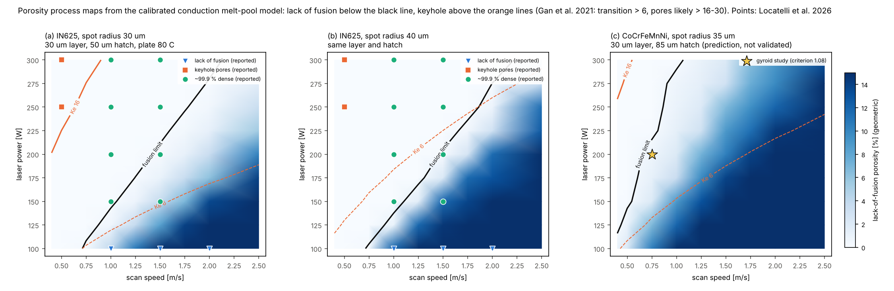

# Porosity process maps: lack of fusion and keyhole

**Question.** For a given machine, layer and hatch, which laser powers and scan speeds give
dense parts? Where do lack-of-fusion and keyhole pores appear, in a single block and inside a
TPMS lattice?

**Method.** Scripts: `benchmarks/literature/porosity_maps.py`; criteria in
`tpmsfem.process.defects`.

1. **Melt pools.** For every (power, speed), the calibrated conduction melt-pool model
   (`MeltPoolModel`: powder layer, evaporation, radiation) runs one track on a plate and gives
   the melt-pool width W and the depth D from the top of the powder layer.
2. **Lack of fusion.**
   * *Criterion* (Tang, Pistorius & Beuth, Addit. Manuf. 14 (2017) 39): full fusion when
     (h/W)² + (L/D)² ≤ 1, for hatch h and layer L.
   * *Unfused fraction:* from overlapping half-elliptical melt pools, with 10 % track-to-track
     scatter. This is a 2-D estimate without the scan rotation between layers, so it
     overstates the porosity. Use it to rank conditions, not for absolute values.
3. **Keyhole.** The keyhole number of Gan et al., Nat. Commun. 12 (2021) 2379:

   Ke = A P / ((T_l − T₀) π ρ c_p √(α v r₀³))

   In their data:
   * conduction below Ke ≈ 1.4;
   * transition between 1.4 and 6;
   * keyhole above 6;
   * keyhole fluctuations small and almost no porosity below Ke ≈ 16; chaotic above ≈ 30.

   Properties are taken at 700 °C, with the fixed absorptivity of the melt-pool model. Gan et
   al. fitted their thresholds with liquid properties at the liquidus and a process
   absorptivity that rises in the keyhole. The analysis on that consistent scale is in
   [keyhole.md](keyhole.md). It supersedes the Ke values below and puts this machine's spot
   radius at 40–46 µm.

Tests: `tests/test_defects.py`. They check the criterion, the limits of the unfused fraction
(for very wide pools it is exactly (L − D)/L), and the scaling of Ke.

## IN625 against Locatelli et al. (2026)

**The experiment.** Locatelli et al., Key Eng. Mater. 1047 (2026) 31. A Print Genius 150,
30 µm layers, 50 µm hatch, plate at 80 °C, 67° rotation, P = 100–300 W, v = 0.5–2.0 m/s. Their
text reports:
* lack of fusion at 100 W, worsening with speed;
* keyhole porosity at 250–300 W and 0.5 m/s;
* about 99.9 % density at 1.0–1.5 m/s for P > 100 W.

**Model inputs.** The spot size is not given, so 1/e² radii of 30 and 40 µm were run. The
absorptivity and absorption depth are those of the AM-Bench case-B calibration (0.3234,
15.3 µm).

| reported | predicted, spot radius 30 µm |
|---|---|
| lack of fusion: 100 W at 1.0, 1.5, 2.0 m/s | all three: criterion 1.37 → 1.77 → 2.18; unfused fraction rising with speed |
| keyhole pores: 250 and 300 W at 0.5 m/s | Ke 17.8 and 21.3, above the ~16 threshold; fully fused |
| dense: 150–300 W at 1.0 and 1.5 m/s | 7 of 8: fused and Ke 6–15. The miss is 150 W at 1.5 m/s, predicted marginal lack of fusion (criterion 1.35) |

**Reading the results.**
* **The maps separate the three regimes as reported.** Lack of fusion lies at low power and
  high speed, keyhole pores at high power and low speed, and the dense window in between.
* **The lack-of-fusion side is slightly conservative.** In the transition regime (Ke > 1.4) the
  real melt pool is deeper than the conduction model's, because a vapour depression starts to
  form. That explains the one miss.
* **The spot size matters.** With a 40 µm radius the reported keyhole cases fall below Ke 16
  (11.5 and 13.8), so the 30 µm radius fits this machine better.
* **The volumetric energy density does not decide.** The same P/(vht) can be dense or porous,
  as Locatelli et al. stress; the maps work with melt-pool geometry and Ke instead.

## CoCrFeMnNi (prediction, not validated)

**Inputs.** A 35 µm spot radius, 30 µm layers and 85 µm hatch: the settings of the gyroid
study. Absorptivity 0.35, uncalibrated. No published power-speed-density table could be
retrieved; the sources found were behind a paywall or gave values only in figures.

**The gyroid study's own point (200 W, 0.75 m/s) sits on the fusion limit** (criterion 1.08,
unfused fraction about 0.7 %). Heat accumulation helps with build height:

| part temperature | where (§7.1 of process_models.md) | W × D | criterion, 85 µm hatch | unfused | criterion, 70 µm hatch | Ke |
|---|---|---|---|---|---|---|
| 80 °C | first layers on the plate | 97 × 54 µm | 1.08 | 0.7 % | 0.83 | 9.0 |
| 140 °C | ~9 mm up | 103 × 55 µm | 0.99 | 0.2 % | 0.77 | 9.5 |
| 300 °C | | 105 × 58 µm | 0.93 | 0.03 % | 0.71 | 11.0 |
| 500 °C | upper bound | 107 × 63 µm | 0.86 | 0 | 0.66 | 13.6 |

* **Lack-of-fusion risk sits near the plate.** It is in the first millimetres, where the part
  is coldest.
* **A 70 µm hatch removes it everywhere.**
* **Keyholes stay below the pore threshold.** Ke rises with the part temperature but stays
  below about 16.
* **Wall thickness does not matter here.** The thin and thick walls differ by less than 1 °C
  in temperature (§7.1).

## Limits

* **Conduction melt pools.** Depths in the transition and keyhole regimes are underestimated:
  the lack-of-fusion side is conservative there, and keyhole pores come from Ke, not from a
  simulated keyhole.
* **The unfused fraction is a 2-D, no-rotation estimate.** Its magnitude is high; the boundary
  (criterion = 1) is the robust part.
* **Not covered:** balling or humping at very high speed, and gas pores from the powder.
  Pores from the keyhole itself and from the powder need the free-surface flow model with
  bubble tracking, on a GPU.
* **Validation.** One IN625 dataset, from its text only (the densities are in figures), and
  the spot size is not reported.
