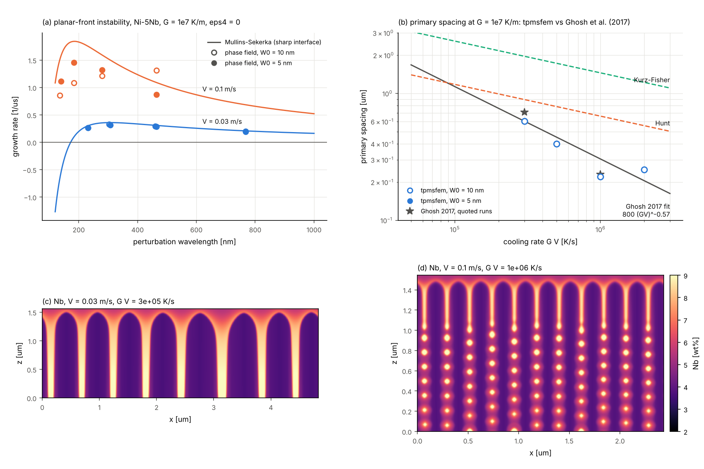
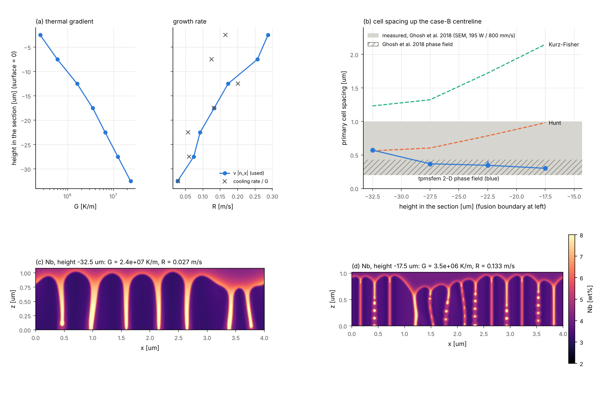
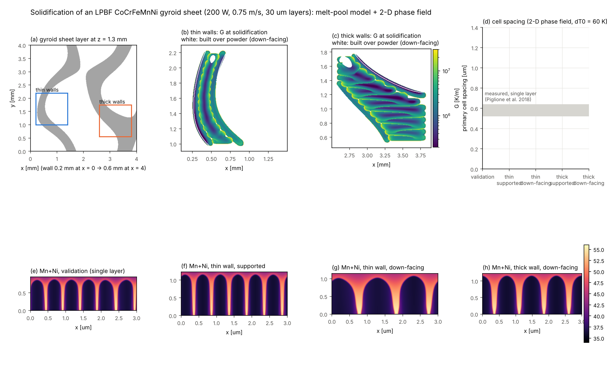
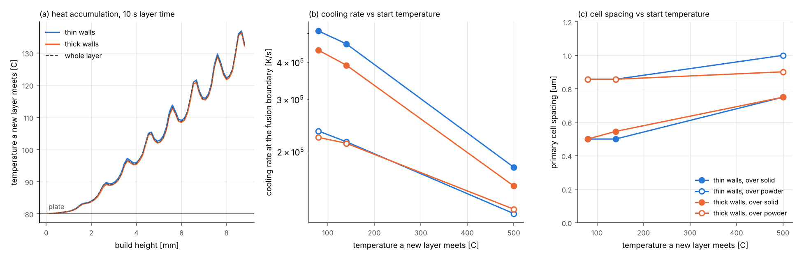
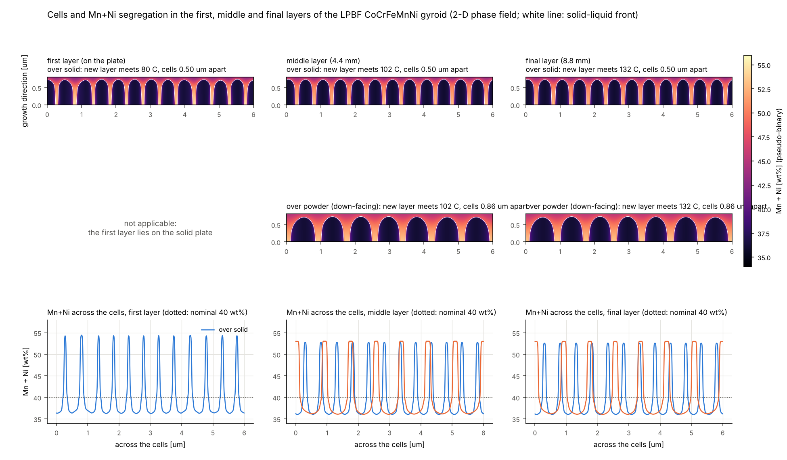
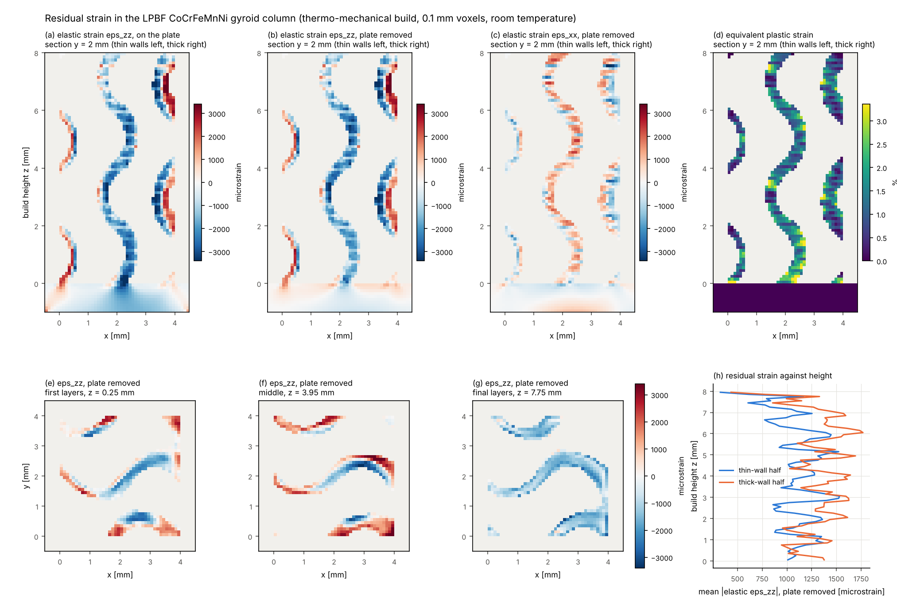
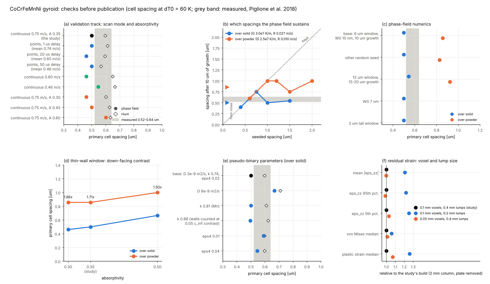

# Process-scale models: laser scan, melt pool, solidification, surface roughness

`tpmsfem.process` adds melt-pool-scale models of laser powder-bed fusion to the part-scale
thermo-mechanical AM model. They form one chain:

    scan path + laser  ->  melt pool (meltpool.py)  ->  G, R, cooling rate, melting times
                                         |                        |
                                         v                        v
                         bead size -> surface roughness   solidification microstructure
                                     (roughness.py)       grains (solidification.py, ExaCA export)
                                                          cells, Nb segregation (phasefield.py)

Everything runs on the NumPy/CuPy backend, so the same code is GPU-ready. The figures and
numbers below come from a 4-core CPU.

## 1. Melt pool (`process/meltpool.py`)

**Physics.** An explicit finite-volume enthalpy method on a structured voxel grid,
`dH/dt = div(k grad T) + q_laser - q_surface`. It includes:

* **Enthalpy.** Sensible and latent heat (solidus to liquidus), inverted to `T` by table
  look-up, so energy is conserved to round-off (tested to 1e-14).
* **Conductivity.** `k(T)` at faces as a harmonic mean, plus an optional anisotropic
  enhancement factor in the liquid. This is the standard conduction-model stand-in for
  Marangoni convection, which is not resolved.
* **Powder.** A powder layer with reduced conductivity, densified when it melts.
* **Laser.** A Gaussian (or top-hat) surface source of absorbed power `A·P`, normalised exactly
  on the grid. An optional absorption depth spreads it into the material.
* **Scan paths.** Scan vectors and raster hatching with jumps.
* **Surface losses.** Radiation, convection, and evaporation (Clausius–Clapeyron vapour
  pressure with a Hertz–Knudsen–Langmuir mass flux and back-condensation). Evaporation caps
  the surface temperature near boiling, at about 3000 to 3500 °C here.
* **Symmetry.** A symmetry plane under a single track halves the cost.
* **Recorded per cell.** Peak temperature, number of melting events, last melting and
  solidification times, and, at solidification, cooling rate, `G = |grad T|`, its direction
  and `R = cooling rate / G`. Probes record surface histories, as a thermal camera does.

**Verification.**
* **Exact solution.** A moving Gaussian source on a semi-infinite body, the Eagar–Tsai
  integral, with constant properties. With 10 µm cells the solver agrees within 1 % at all
  checked points. The analytic routine itself reproduces Rosenthal's point-source solution
  to 6 digits.
* **Energy balance.** With latent heat and surface losses, the enthalpy balance closes to
  1e-9 or better.

**Validation, NIST AM-Bench 2018-02** (single tracks on bare IN625, NIST AMMT testbed): see §4.

## 2. Solidification microstructure (`process/solidification.py`)

* **G–R map.** Thermal gradient and solidification velocity at the last liquidus crossing of
  every melted cell, the cooling rate `G·R`, and the morphology indicator `G/R`.
* **Cell and dendrite spacing.** Kurz–Fisher (`4.3 (ΔT0 D Γ / k)^¼ G^-½ R^-¼`), Hunt, or a
  user-fitted cooling-rate law.
* **Columnar-to-equiaxed transition.** Hunt's (1984) criterion with a tip-undercooling growth
  law.
* **Grains.** A reduced cellular-automaton model of epitaxial, competitive columnar growth.
  * Melted cells re-solidify in time order.
  * Each one takes the grain of an already solid neighbour. The choice is weighted by how
    well that grain's nearest <100> axis aligns with the local growth direction (grad T at
    solidification), so well-oriented grains crowd out the others.
  * Equiaxed grains nucleate where Hunt predicts equiaxed growth.
  * Outputs: grain maps, inverse-pole-figure colours and texture fractions.
* **ExaCA export.** `x,y,z,tm,tl,cr` CSV (SI units) for ORNL's open-source GPU
  cellular-automaton code. Use it when the full decentred-octahedron kinetics matter.
* **Cells and dendrites, resolved** (`process/phasefield.py`, §5.3). A 2-D quantitative
  phase-field model grows the cell array itself at a melt-pool (G, R). It gives the spacing,
  the cell or dendrite morphology and the Nb segregation between cells, which the spacing
  laws above only estimate.

**Constants.** The alloy constants (Gibbs–Thomson, diffusivity, partition coefficient,
nucleation density, growth law) are inputs. The defaults are generic Ni–Nb values and are
**not calibrated for IN625**.

## 3. Surface roughness (`process/roughness.py`)

The as-built topography of a surface tilted by θ from the build direction is the
superposition of three parts:
* **Layer staircase.** Peak-to-valley `t |cos θ|`, so `Ra = t |cos θ|/4` for sharp steps.
* **Melt-pool rounding.** Morphological closing with the bead radius, taken from the
  melt-pool model.
* **Partially fused powder.** Spheres from the powder size distribution, stuck on as a
  Poisson process. Their density rises on down-facing surfaces and falls on up-facing ones.

Roughness parameters follow ISO 4287 and 25178 (Ra, Rq, Rz; Sa, Sq, Sz). `roughness_map` puts
the model onto any triangulated surface (for example a TPMS implant) by facet inclination.

**Validation, Kasperovich et al. 2021** (LPBF IN718, 30 µm layers): see §5.

## 4. AM-Bench 2018-02 single tracks (melt pool)

NIST laser tracks on bare IN625 plate, AMMT testbed: 1070 nm, D4σ = 170 µm (Gaussian 1/e²
radius 85 µm), true powers 137.9 / 179.2 / 179.2 W. Measurements are from the
[AMB2018-02 description](https://www.nist.gov/ambench/amb2018-02-description) and its
melt-pool-length, cross-section and cooling-rate result pages.

**Model set-up.**
* 5 µm cells, half-symmetric domain 1.9 × 0.3 × 0.2 mm, 1.5 mm track.
* Evaporation on. The liquid is not enhanced: enhancing it in depth would have needed a
  factor of about 7.

**Calibration on case B**, NIST's calibration case. Two parameters are fitted to its width
and depth:
* absorptivity A = 0.323;
* absorption depth δ = 15.3 µm (exponential), the usual effective treatment of the shallow
  vapour depression at about 1.6 MW/cm² peak intensity.

Without δ, absorptivity alone (0.206) matches the width but gives only 22 µm depth. Cases A
and C are predictions:

| case | P, v | quantity | measured (NIST AMMT) | tpmsfem | diff |
|---|---|---|---:|---:|---:|
| A (prediction) | 137.9 W, 400 mm/s | melt-pool width | 147.9 ± 3.7 µm | 141.7 µm | −4 % |
| A (prediction) | 137.9 W, 400 mm/s | melt-pool depth | 42.5 ± 1.7 µm | 47.2 µm | +11 % |
| A (prediction) | 137.9 W, 400 mm/s | melt-pool length (solidus) | 300 ± 12 µm | 357 µm | +19 % |
| B (calibration) | 179.2 W, 800 mm/s | width / depth (fitted) | 123.5 / 36.0 µm | 123.3 / 36.0 µm | 0 % |
| B (calibration) | 179.2 W, 800 mm/s | melt-pool length (solidus) | 359 ± 20 µm | 414 µm | +15 % |
| C (prediction) | 179.2 W, 1200 mm/s | melt-pool width | 106.0 ± 1.4 µm | 100.9 µm | −5 % |
| C (prediction) | 179.2 W, 1200 mm/s | melt-pool depth | 29.6 ± 0.6 µm | 24.7 µm | −17 % |
| C (prediction) | 179.2 W, 1200 mm/s | melt-pool length (solidus) | 370 ± 10 µm | 344 µm | −7 % |
| A / B / C | | surface cooling rate 1290→1190 °C | 1.2 / 1.1 / 1.9 ×10⁶ K/s | 3.3 / 5.9 / 8.9 ×10⁶ K/s | 3–5× too high |

**Reading the results.**
* **Widths** are predicted within 5 %.
* **Depths** are within −17 % to +11 %, but the speed trend is too steep: too deep at
  400 mm/s, too shallow at 1200 mm/s. One fixed absorption depth cannot follow a vapour
  depression that deepens at low speed. A speed- or intensity-dependent δ, or a
  free-surface model, would.
* **Lengths** are within −7 % to +19 %. The two NIST machines differ by about 2× in measured
  length (CBM 659–782 µm), and NIST left the cause open.
* **Cooling rates** are 3–5× higher than NIST's thermography. The camera's spatial and
  temporal resolution and the emissivity assumption smear the steep solidification-front
  gradient, which likely contributes. NIST also reports that the two machines' cooling rates
  "differ drastically". The model, however, also omits fluid flow in the melt pool, which reshapes the temperature
  field near the solidification front. The predicted rates are therefore not validated.
* **Cost.** One case-B run takes 2.5 minutes on 4 CPU cores (2,528 explicit steps, 0.96 M cells).

## 5. Solidification and grains (track B)

`examples/05_lpbf_meltpool_microstructure.py` (summary in `results/process/summary.json`):

| quantity (re-solidified cells of track B, 5–50–95th percentiles) | value |
|---|---|
| thermal gradient G | 5.1e+05 / 7.3e+06 / 2.5e+07 K/m |
| solidification velocity R | 0.017 / 0.086 / 0.28 m/s (scan speed 0.8 m/s) |
| cooling rate G·R at the liquidus | 7.5e+04 / 5.2e+05 / 1.6e+06 K/s |
| primary spacing, Kurz–Fisher (generic constants) | 1.16 / 1.82 / 5.89 µm |
| Hunt CET (CMSX-4 constants): columnar / mixed / equiaxed | 43 / 36 / 22 % of the fusion zone |
| grains in the fusion zone (30 µm substrate grains, purely epitaxial) | 110; <100> within 15° of the build direction in 16 % of the volume (random: about 10 %) |
| ExaCA export | 18,296 cells (`results/process/exaca_track_B.csv`) |
| 5-track hatch on 20 µm powder | up to 3 melting events per cell; 638 grains in the fused region |

* **Cooling at the liquidus.** The cooling rate at the liquidus crossing is about 10× lower
  than the surface rate between 1290 and 1190 °C: latent heat slows cooling in the mushy zone.
* **Texture.** Competitive growth gives a mild <100> texture along the build direction.
* **First layer.** The grains of the first layer are inherited epitaxially from the plate.

### 5.1 Grains against NIST's EBSD map (case B)

**Data.** NIST's example EBSD map of a case-B track: a transverse cross-section, Oxford
`.ctf` with 1218 × 890 points at 0.14 µm
([AMB2018-02_CaseB_EBSDdata.zip](https://s3.amazonaws.com/nist-midas/1889/AMB2018-02_CaseB_EBSDdata.zip)).
It is analysed with `tpmsfem.process.ebsd`: CTF reader, Bunge orientations, cubic
disorientation, grain segmentation at 10° and kernel misorientation. The script is
`benchmarks/literature/nist_ambench2018_tracks_ebsd.py`.

**Test.** The melt pool grows epitaxially from the plate's grains, so the measured
substrate fixes the initial condition. The measured orientations *inside* the model's fusion
line are hidden and regrown from the substrate:
* in the order of the simulated solidification times;
* along the simulated growth direction (grad T at solidification) of the steady-state
  case-B section;
* on the 0.28 µm EBSD grid (2 × 2 binning).

The prediction is compared with the measurement pixel by pixel.

**Placement.** The fusion line is the calibrated model's, which matches NIST's case-B mean
size. Its centre is put where the elongated grains change their lean (x = 82.4 µm). Depth is
measured from the local surface.

| regrowth of the melt pool (3116 µm², 39,749 px) | pixels within 10° of measured | grains (10°) | area-weighted grain size |
|---|---:|---:|---:|
| measured | — | 92 | 10.1 µm |
| tpmsfem, epitaxy along the simulated thermal gradient (trace back to the substrate) | **27.5 %** | 83 | 12.3 µm |
| tpmsfem, upstream-neighbour rule (`grow_grains(rule="upstream")`) | 26.6 % | 50 | 13.1 µm |
| tpmsfem, competitive growth (`grow_grains`, default) | 26.4 % | 45 | 14.5 µm |
| tpmsfem, dendrite-arm capture rule | 21.0 % | 42 | 14.5 µm |
| baseline: copy the nearest fusion-line grain | 25.8 % | 51 | 13.0 µm |
| baseline: copy the grain straight below | 19.8 % | — | — |
| random orientations | 0.5 % | — | — |

**Reading the results.**
* **The fan of columnar grains comes from epitaxy.** It converges toward the top centre, and
  so does the simulated one. About a quarter of the melt pool, point by point, is the plate
  grain directly below or beside it, extended along the thermal gradient.
* **The gradient direction helps a little.** Following the simulated gradient is slightly
  better than following the fusion-line normal (27.5 % vs 25.8 %), and it reproduces the
  grain count: 83 against 92 measured.
* **Competition adds nothing here.** Selecting grains by <100> alignment does not improve
  point-wise agreement over this short, 36 µm growth distance. It merges grains (45 against
  92). An earlier, slightly smaller fusion-zone definition gave the competitive rule a texture
  match (9.6 % against 10.9 % <100> within 15° of the build direction). That match vanished
  with the smoother definition, so it is not claimed.
* **The fusion line checks out independently.** The model's fusion line follows the
  measured boundary between columnar and equiaxed grains.
* **The test has a ceiling.**
  * It is a 2-D test: grains can enter the section from substrate above or below the plane.
  * The fusion line is the model's, not a measured one.
  * The unmelted plate is fine-grained (median equivalent diameter 4.2 µm, many annealing
    twins).
  * The model resolves the thermal field at 5 µm.

### 5.2 3-D test: where the section's grains come from

**What the 2-D test assumed.** In a moving melt pool the growth direction also points
forward along the scan, so a grain seen in the transverse section may have started on the
fusion boundary *behind* it. The 2-D regrowth assumed every grain started in the measured
plane.

**Method.** `benchmarks/literature/nist_ambench2018_tracks_ebsd3d.py` traces each melt-pool
pixel of the section backwards through the simulated **3-D** steady-state growth-direction
field of case B, until it leaves the melt pool. That point is where its grain started.

**Origins.** All 39,749 traces reach the fusion boundary, after a median path of
11 µm.
* **Distance behind the section.** The median origin lies 0.8 µm behind
  the section, the 90th percentile 3.6 µm.
* **Where.** Grains near the top centre start furthest back; along the sides and bottom they
  start in the plane.
* **In-plane share.** 64 % of the pixels have an origin within
  ±1.4 µm of the plane, half the measured median substrate grain size of
  2.7 µm.

**Parameter-free check.** Give every pixel the measured in-plane substrate orientation at its
origin's (y, z), then bin the agreement by the origin's distance from the plane:

| origin behind the section | share of melt-pool pixels | within 10° of measured |
|---|---:|---:|
| 0–0.5 µm | 39.5 % | 51.2 % |
| 0.5–1 µm | 15.6 % | 30.8 % |
| 1–1.5 µm | 11.1 % | 11.8 % |
| 1.5–2 µm | 8.3 % | 7.4 % |
| 2–3 µm | 11.3 % | 7.8 % |
| 3–4 µm | 6.9 % | 7.2 % |
| 4–6 µm | 7.2 % | 6.3 % |
| random orientations | | 0.6 % |

* **Agreement follows the origin's distance.** Half of the pixels whose grains start within
  0.5 µm of the measured plane are predicted correctly. Agreement falls to a residual 6–8 %
  once the origin lies 1.5 µm or more behind it. The residual exceeds random because large
  substrate grains reach a few µm out of the plane.
* **The prediction is confirmed.** The point-wise failures of the 2-D test are explained by
  grains from substrate NIST did not measure, and their share is predicted by the 3-D thermal
  field.

**Hybrid prediction.** Use the measured orientations for in-plane origins, and a
statistically equivalent 3-D substrate elsewhere: Voronoi grains whose orientations are drawn
from the measured substrate, 5 realisations.
* **All pixels:** 26.7 ± 0.6 % within 10°.
* **In-plane origins:** 41 %.
* **Upstream origins:** 1.5 %, close to random.
* **Ceiling.** The 2-D result (27.5 %) is close to the best that can be expected from a single
  section. Doing better needs the substrate in 3-D, for example from serial sections.

**Grain count.** The hybrid predicts 236 grains in the section with
2.7 µm stand-in substrate grains, against
92 measured. With the area-weighted size
(7.9 µm) it predicts 121. The
unmeasured 3-D substrate grain size sets the count of the upstream-origin grains.

The remaining NIST track files (SEM and EBSD maps of tracks 3, 5 and 10, the 10 optical
cross-sections of mds2-3830) did not download: they returned server errors, HTTP 500, on
2026-11-07.

### 5.3 Cells and Nb segregation: 2-D quantitative phase field

**Why a phase field.** The grain model (§2, §5.1–5.2) places grains but not the cells inside
them.
* In LPBF IN625 each grain solidifies as an array of sub-micron cells.
* Nb is rejected into the liquid between the cells. The Laves phase and NbC that form there
  control the heat-treatment response, corrosion and fatigue.
* The spacing laws (Kurz–Fisher, Hunt) only give an estimate.

`process/phasefield.py` grows the cell array itself at a melt-pool (G, R).

**Model.** The quantitative thin-interface phase field of a dilute binary alloy in
directional solidification (Karma 2001; Echebarria, Folch, Karma & Plapp 2004).
* **Variables.** A phase field `φ` (+1 solid, −1 liquid) and the supersaturation `U`.
* **Temperature.** Frozen: `T = T0 + G (z − V t)`, with the melt-pool G and R as inputs.
* **Thin-interface terms.** An anti-trapping current, plus `λ = a1 W0/d0` and
  `τ0 = a2 λ W0²/D` (a1 = 0.8839, a2 = 0.6267). These remove the spurious interface effects
  (solute trapping, a jump in chemical potential, kinetic undercooling) to second order in the
  interface width `W0`.
* **Anisotropy.** Four-fold, `1 + ε4 cos 4(ψ − ψ0)`; the crystal can be tilted from the
  gradient.
* **Diffusion.** One-sided: no diffusion in the solid.

**Numerics.**
* **Grid.** Explicit conservative finite volumes with `dx = 0.8 W0`, periodic across the growth
  direction.
* **Moving window.** The window follows the front. The rows that leave it are kept as the
  solidified Nb map.
* **Kernel.** A fused numba kernel runs at 7 ns per cell and step on 4 CPU cores, 18× the NumPy
  array path; the two agree to 1e-15. The array code also runs on CuPy GPUs.
* **Alloy.** IN625 is quasi-binary Ni–4 wt% Nb, as in Ghosh et al. (2018): k = 0.48,
  m = −10.5 K/wt%, D = 3e-9 m²/s, Γ = 3.65e-7 K m, ε4 = 0.02, so ΔT0 = 45.5 K and d0 = 8.0 nm
  (`phasefield.IN625_NB`).

**Measurements.**
* **Spacing.** The width divided by the number of Nb-rich cell boundaries. Boundaries are counted,
  as on a micrograph, on lines 25–50 % of the tip height below the leading tip. A boundary
  counts when it stands 0.2 c∞ above the neighbouring cell cores.
  * A relative threshold failed: the strongly enriched liquid droplets set the scale and the
    solid boundaries dropped below it.
  * Counting tips failed too: at high G, the active tips of a coarsening array are further
    apart in height than any fixed band.
* **Tip compositions.** c_s* is the solid composition just behind each active tip, c_l* the
  liquid peak just ahead of it.

**Verification** (`tests/test_phasefield.py`, `benchmarks/literature/ghosh_2017_phasefield.py`).
* **Exactness.** Solute is conserved to 1e-14 in a closed box.
* **Stability limits.** A planar front stays planar below the constitutional limit
  `V_cs = D G/ΔT0`, sitting at the solidus. It breaks into cells above.
* **Growth rates.** Small front perturbations follow the Mullins–Sekerka dispersion relation
  (one-sided, frozen temperature, non-quasi-static). With D/V = 20 W0 the growth rates agree
  within 5 % across the unstable band, at W0 = 2.5 d0 and 1.25 d0.
* **At AM speeds** (Ni–5Nb, G = 1e7 K/m, ε4 = 0), the ratio of phase-field to Mullins–Sekerka
  growth rate is:

| V | W0 = 10 nm | W0 = 5 nm |
|---|---|---|
| 0.03 m/s (D/V = 10 and 20 W0) | 0.88–0.94 | 0.88–0.96 |
| 0.1 m/s (D/V = 3 and 6 W0) | 0.57–0.76 | 0.70–0.83 |

  The thin-interface model stays quantitative where D/V ≳ 10 W0, i.e. up to about 0.03 m/s at
  W0 = 10 nm. Faster growth needs a thinner interface, and the cost rises as W0^-4. Ghosh et al.
  (2017) reach the same conclusion. They find the anti-trapping current "not adequate to
  eliminate solute-trapping at these high solidification rates".

**Code-to-code: Ghosh, Ma, Ofori-Opoku & Guyer, MSMSE 25 (2017) 065002.** Their setup is the
same model class:
* Ni–5 wt% Nb, k = 0.48, m = −10.5 K/wt%, D = 3e-9 m²/s, Γ = 3.65e-7 K m, ε4 = 0.03;
* W0 = 10 nm, dx = 8 nm, 2-D, frozen temperature, G = 1e7 K/m.

| V | cooling rate G V | tpmsfem spacing | Ghosh 2017 | c_s* tpmsfem / Ghosh | c_l* tpmsfem / Ghosh |
|---|---|---|---|---|---|
| 0.03 m/s | 3e5 K/s | 0.604 µm | 0.604 µm (fit), 0.71 µm (run quoted) | 3.78 / 3.65 wt% | 6.81 / 6.87 wt% |
| 0.05 m/s | 5e5 K/s | 0.402 µm | 0.452 µm (fit) | 3.85 wt% | 6.68 wt% |
| 0.1 m/s | 1e6 K/s | 0.221 µm (W0 = 10 nm), **0.304 µm (W0 = 5 nm)** | 0.23 µm (run quoted), 0.304 µm (fit) | 3.94 / 4.04 wt% | 6.42 / 6.94 wt% |
| 0.2 m/s | 2e6 K/s | 0.250 µm | 0.205 µm (fit) | 4.37 wt% | 6.46 wt% |

Their fit is `PDAS = 800 µm (G V)^-0.57`. Hunt's law gives 0.56–0.89 µm and Kurz–Fisher's
1.2–2.0 µm over the same range.

**Application: AM-Bench case B against the measured IN625 cells**
(`benchmarks/literature/nist_ambench2018_tracks_pf.py`).
* **Inputs.** The calibrated case-B melt pool gives G and R at four heights up the centreline
  of the x = 0.7 mm section. R is `v |n_x|`, which is smoother on 5 µm voxels than cooling
  rate / G.
* **Run.** The phase field runs at W0 = 10 nm, 4 µm wide, over 12 µm of growth.
* **Measurement.** Ghosh, Ma, Levine, Ricker, Stoudt, Heigel & Guyer, JOM 70 (2018) 1011,
  measured an average primary spacing of about 0.2–1.0 µm by SEM. The track was on an IN625
  plate at 195 W / 800 mm/s, the nominal setting nearest case B. The cells are coarse at the
  pool bottom and fine towards its rear. Their own phase field gives 0.20–0.43 µm.

| height above the fusion boundary | G | R | D/V | spacing, phase field | Hunt | c_s* | c_l* |
|---|---|---|---|---|---|---|---|
| 0 µm (lowest melted row) | 2.4e7 K/m | 0.027 m/s | 11 W0 | 0.57 µm | 0.56 µm | 3.23 wt% | 5.83 wt% |
| 5 µm | 1.25e7 K/m | 0.074 m/s | 4.1 W0 | 0.37 µm | 0.60 µm | 3.34 wt% | 5.49 wt% |
| 10 µm | 6.6e6 K/m | 0.092 m/s | 3.3 W0 | 0.35 µm | 0.79 µm | 3.35 wt% | 5.40 wt% |
| 15 µm | 3.5e6 K/m | 0.133 m/s | 2.3 W0 | 0.30 µm | 0.98 µm | 3.44 wt% | 5.29 wt% |

**Reading the results.**
* **Code to code.** At the shared W0 = 10 nm the phase field reproduces Ghosh et al.'s cell
  spacing within their own scatter: their quoted run at 3e5 K/s lies 18 % above their fit.
* **Convergence at 0.1 m/s.** Halving W0 to 5 nm raises the spacing from 0.221 to 0.304 µm
  (+38 %), onto Ghosh's fit. At D/V = 3 W0 a 10 nm interface therefore under-predicts the
  spacing by about a quarter. The close match to Ghosh's 0.23 µm quoted run is most likely two
  codes sharing the same under-resolution. The 5 nm result is not proven converged either
  (Mullins–Sekerka rates still 17–30 % low at D/V = 6 W0). At 0.03 m/s the tip
  compositions agree within 4 % (solid) and 1 % (liquid). The effective partition
  coefficient c_s*/c_l* rises with V, from 0.55 to 0.68 against k = 0.48.
* **Against the measurement.** All four case-B spacings lie inside the measured 0.2–1.0 µm.
  * They fall from 0.57 µm at the fusion boundary to 0.30 µm higher up, as the micrographs
    show.
  * Hunt's law trends the other way (0.56 → 0.98 µm), because G falls faster than R rises.
  * The measurement is a single range from one micrograph, so this is a consistency check,
    not a point-wise validation.
* **The Nb segregation is of the right size.** At the fusion boundary the cell cores hold
  3.2 wt% Nb and the liquid at the tips 5.8 wt% (Ghosh 2018 phase field: 3.7 / 5.1 wt%).
  Deeper in the mushy zone, intercellular droplets reach 9 wt% in the 2 µm window. Ghosh 2017
  report 15.8 wt% in a 40 µm domain. The value keeps rising with depth because the binary model
  has no eutectic or Laves reaction to cap it.
* **Limits.**
  * Only the fusion-boundary point satisfies D/V ≥ 10 W0. The three points above it
    (D/V = 2.3–4 W0) are probably under-predicted by 30 % or more, by the 0.1 m/s convergence
    test. Corrected that way they become roughly 0.45–0.5 µm, still inside the measured range,
    but the downward trend from the fusion boundary is then weaker than the table shows.
  * The model is 2-D, and 2-D cell arrays are coarser than 3-D ones.
  * The temperature field is frozen (no latent heat at this scale).
  * Non-equilibrium solute trapping beyond what the diffuse interface gives is not modelled.
  * IN625 is treated as a binary.

## 6. Roughness vs build angle (Kasperovich et al. 2021, LPBF IN718)

Kasperovich, Becker, Artzt et al., *Materials & Design* 207 (2021) 109858,
doi:10.1016/j.matdes.2021.109858 (gold open access).
* **Build.** Concept Laser M2, 30 µm layers, powder D10/D50/D90 = 22/33/45 µm.
* **Measurement.** Sa by laser scanning microscopy on 2.44 × 2.44 mm² of flat outer surfaces
  at 45° (upskin), 90° (vertical) and 135° (downskin).
* **Model inputs.** The edge radius is half the width of the contour track (180 W,
  1600 mm/s) from the calibrated melt-pool model: 85 µm wide, so 43 µm.
* **Fit.** The three particle parameters are fitted to the three measured Sa values. This is
  a calibrated description, not a prediction.

| contour | measured Sa 45° / 90° / 135° | fitted model | particles on a vertical wall | downskin / upskin factors |
|---|---|---|---:|---:|
| 180 W, 1600 mm/s (E_L 0.113 J/mm) | 9.01 ± 0.33 / 11.17 ± 1.44 / 52.80 ± 3.41 µm | 9.02 / 11.16 / 52.80 µm | 268 /mm² | k_down 4.3, k_up 0.33 |
| optimum, E_L 0.18 J/mm | 6.8 / 7.2 / 47.5 µm | 6.79 / 7.22 / 47.21 µm | 179 /mm² | 6.2, 0.18 |

**Reading the results.**
* **Parts of the roughness.** The layer staircase and melt-pool rounding alone give only
  0–5 µm. Powder stuck to the surface dominates, especially on down-facing surfaces, which
  rest on the powder bed.
* **TPMS application.** On a 3 mm, 30 %-dense gyroid sheet cell, 30 % of the area faces
  down by more than 120°. The area-weighted Sa is therefore 26 µm, against 11 µm for a
  vertical wall.
* **Why it matters.** For lattice implants this roughness is
  * a fatigue concern (notches),
  * a fluid-flow and osseointegration factor,
  * and a reason the as-built stiffness of thin sheets falls below the CAD value.

## 7. Solidification of a CoCrFeMnNi (Cantor alloy) gyroid lattice

**Question.** How do the solidification conditions, cells, Mn/Ni segregation and grain texture
of an LPBF gyroid-sheet lattice in the equiatomic CoCrFeMnNi high-entropy alloy change between
thin and thick walls, and on down-facing surfaces built over powder? No study of
CoCrFeMnNi TPMS solidification turned up in the literature. Script:
`benchmarks/literature/cantor_gyroid_solidification.py`.

**New model pieces.**
* **Part-aware substrate.** `MeltPoolModel.set_part_geometry`: the substrate is the part built
  so far, an implicit field, with loose powder elsewhere. Down-facing regions of a new layer
  therefore sit on powder.
* **Preheat.** `MeltPoolModel.set_temperature` sets a preheat field.
* **Scan paths.** `process/scanpath.py` builds contour and hatch vectors clipped to one layer
  of an implicit part, with laser-off jumps between them.
* **Wall thickness.** `geometry.tpms.sheet_with_thickness`: a TPMS sheet with a prescribed or
  graded wall thickness, from `f/|grad f|`. On a 3-D grid the thin-wall volume fraction is
  within 3 % of `t · S/V`.

**Alloy data** (`benchmarks/literature/cantor_material.py`).
* **Thermal.** k(T), cp(T), density 7980 kg/m³, latent heat 2.2e5 J/kg, solidus 1250 °C and
  liquidus 1340 °C, from Li et al., J. Mater. Sci. Technol. 77 (2021) 187. These are the
  inputs of their laser-deposition simulation; the paper does not give their measurement
  source.
* **Segregation.** The cell cores keep Co, Cr and Fe, and the walls collect Mn and Ni. The
  phase field uses the pseudo-binary CrFeCo–(MnNi): solute Mn + Ni at 40 wt%, k = 0.74.
  A laser-remelting study reports k_Mn = 0.81 and k_Ni = 0.92.
* **Freezing range.** The least certain input. It is run at 40, 60 (baseline) and 90 K.
* **Evaporation.** Mn evaporation at its 20 at% (Raoult's law).

**Validation: Piglione et al., Mater. Lett. 224 (2018) 22** (open access).
* **Their build.** A single LPBF layer of 11 tracks on a Renishaw AM250: 200 W, 80 µs
  exposure, 60 µm point distance, 125 µm hatch.
* **Their measurement.** Cell spacing 0.52–0.64 µm, mean 0.59 µm. The cells grow with a <001>
  axis normal to the fusion line.
* **Model setup.**
  * The same power and a 70 µm spot, scanned continuously at 0.75 m/s.
  * Absorptivity 0.35 and absorption depth 15 µm, not calibrated for this alloy.
  * A 30 µm powder layer on a Cantor plate.
* **Melt pool.** 97 µm wide; it melts through the powder and 24 µm into the plate. The
  fusion-boundary medians are G = 3.0e7 K/m and R = 0.027 m/s.

| freezing range | phase-field spacing (6 µm window) | Hunt | Kurz–Fisher | measured |
|---|---|---|---|---|
| 40 K | 0.50 µm | 0.54 µm | 0.95 µm | 0.52–0.64 µm (mean 0.59) |
| 60 K | 0.50 µm | 0.60 µm | 1.05 µm | |
| 90 K | 0.46 µm | 0.66 µm | 1.17 µm | |

The phase field is 15–22 % below the measured mean. Candidate causes:
* The AM250 exposes point by point with pauses, so its mean speed is below the 0.75 m/s
  assumed here, and a slower front grows coarser cells.
* The absorptivity is a guess.
* 10 µm of growth may stop short of full coarsening.

**Gyroid.**
* **Geometry.** A gyroid sheet with a 4 mm cell, its wall thickness graded linearly from
  0.2 mm at x = 0 to 0.6 mm at x = 4 mm.
* **Process.** The validation settings, 30 µm layers, 85 µm hatch, one contour, no rotation.
* **Windows.** Two 1.2 mm windows of the layer at 1.3 mm build height are simulated with the
  real solid and powder substrate and the clipped scan path: thin walls with a median of
  0.25 mm, and thick walls with a median of 0.52 mm.
* **Classes.** A fusion-boundary column is *down-facing* when the layer below it was powder.
  That covers 7.5 % of the melted columns in the thin window and 3.4 % in the thick one.

| walls | material below | G (median) | R (median) | cooling rate | cell spacing | Mn+Ni: cores / tip liquid / max between cells |
|---|---|---|---|---|---|---|
| thin (0.25 mm) | solid | 2.2e7 K/m | 0.025 m/s | 5.1e5 K/s | 0.50 µm | 0.91 / 1.16 / 1.37 × nominal |
| thin | powder | 2.5e7 K/m | 0.010 m/s | 2.3e5 K/s | **0.86 µm** | 0.91 / 1.19 / 1.38 |
| thick (0.52 mm) | solid | 1.85e7 K/m | 0.025 m/s | 4.4e5 K/s | 0.50 µm | 0.91 / 1.16 / 1.32 |
| thick | powder | 2.4e7 K/m | 0.010 m/s | 2.2e5 K/s | **0.86 µm** | 0.91 / 1.19 / 1.38 |

**Reading the results.**
* **Down-facing surfaces solidify differently. Wall thickness barely matters within a layer.**
  * Over powder, the solidification front at the fusion boundary moves 2.5× slower and cools
    half as fast.
  * The cells there are 1.7× coarser: 0.86 against 0.50 µm, in both thin and thick walls.
  * A homogenisation anneal needs a time that scales with the cell spacing squared, so the
    down-facing skin needs about 3× longer to homogenise than the rest of the lattice.
* **Thick walls are not hotter in a single layer.** Their gradient is 15 % *lower*, because
  more hatch tracks preheat each other, but that does not change the cell spacing.
* **Segregation is mild, as expected for k close to 1.** Cell cores hold about 0.91× the
  nominal Mn + Ni, and the last liquid about 1.4×, roughly 55 wt% Mn + Ni against 40.
  * This is much weaker than Nb in IN625 (k = 0.48).
  * It is consistent with the absence of second phases in as-built LPBF CoCrFeMnNi.
* **Texture.** After one layer grown from random substrate grains, 12.6–13.6 % of the
  fusion zone has a <100> within 15° of the build direction (random: 10.2 %). The strong
  <001> build texture reported for LPBF CoCrFeMnNi needs many layers of competitive growth,
  which this study does not simulate.

**Limits.**
* **One layer only.** Heat accumulation over many layers is not included, and in thin
  lattice walls it should raise the temperature and lower G as the build grows. A
  part-scale thermal model (`thermal/heat.py`) on the lattice could supply that preheat
  through `set_temperature`.
* **No keyhole physics.** With a 70 µm spot at 200 W the absorbed intensity is about
  36 kW/mm², and the conduction model caps the surface only at about 5400 °C. It has no
  keyhole, recoil pressure or Marangoni flow, so peak temperatures are not physical. The
  fusion-boundary G and R follow from the overall energy balance.
* **Uncalibrated inputs.** Absorptivity, layer thickness and the property data are not
  calibrated for CoCrFeMnNi.
* **Simplified solidification model.** The phase field is 2-D, and the alloy is treated as
  a pseudo-binary with an uncertain freezing range.
* **Mn loss is not tracked.** Mn evaporation cools the surface, but the loss of Mn from the
  alloy is not computed.

### 7.1 Heat accumulation over many layers

**Question.** §7 simulated one layer on an 80 °C substrate. Does heat building up over many
layers change the picture, and does it separate thin from thick walls? Script:
`benchmarks/literature/cantor_gyroid_multilayer.py`.

**Part-scale build** (`thermal/heat.py`).
* **Geometry.** One 4 × 4 mm gyroid cell column with the graded walls, on a 2 mm plate whose
  bottom is held at 80 °C. The surrounding powder is part of the model (2 % of the solid
  conductivity). The side faces are adiabatic, as for a cell inside a large lattice.
* **Layers.** 30 µm layers, 10 s per layer, lumped into 0.133 mm lumps on 1/15 mm voxels.
* **Energy input.** Each lump receives the energy of its layers where the laser puts it. The
  contour and hatch path of the slice deposits `f_net · A · P / v` per unit length.
  `f_net = 0.70` is the share of the absorbed energy that stays in the part in a single-track
  melt-pool run; the rest evaporates or radiates from the pool. That is about 3.1–3.9 J per
  layer for the cell.
* **Timing.** The lump's energy arrives in four pulses 1.1 layer times apart, so the
  temperature just before a pulse is what a new layer meets. Depositing a lump at once and
  waiting 4.4 layer times understates it.
* **Extent.** The build was simulated to 8.8 mm (66 of 75 lumps). The run was interrupted
  twice by infrastructure restarts; the two runs agree to 0.1 °C where they overlap.

**Result.**
* **Rise with height.** The temperature a new layer meets rises about 7 °C per millimetre of
  build height once the column is a few millimetres tall: 97 °C at 4.1 mm and 132 °C at
  8.8 mm. It wobbles by about ±5 °C with the slice.
* **No thin/thick difference.** The thin-wall and thick-wall regions never differ by more
  than 1 °C. Heat spreads sideways through the lattice much faster than a layer takes.

**Effect on solidification.** The two melt-pool windows of §7 were re-run with the part
starting hotter, followed by the phase field:
* at 140 °C, the preheat at 9.3 mm (extrapolated from 8.8 mm; this is the slice of §7 two
  cells higher);
* at 500 °C, an upper-bound case. On the 7 °C/mm slope that is a part about 60 mm tall at a
  10 s layer time, or a shorter part with a shorter layer time. The slope is extrapolated,
  not simulated, beyond 8.8 mm.

| start temperature | walls | below | G [K/m] | R [m/s] | cooling rate [K/s] | cell spacing |
|---|---|---|---|---|---|---|
| 80 °C (single layer) | thin / thick | solid | 2.2e7 / 1.85e7 | 0.025 | 5.1e5 / 4.4e5 | 0.50 / 0.50 µm |
| | thin / thick | powder | 2.5e7 / 2.4e7 | 0.010 | 2.3e5 / 2.2e5 | 0.86 / 0.86 µm |
| 140 °C (9.3 mm up) | thin / thick | solid | 2.0e7 / 1.7e7 | 0.025 / 0.024 | 4.6e5 / 3.9e5 | 0.50 / 0.55 µm |
| | thin / thick | powder | 2.5e7 / 2.2e7 | 0.010 / 0.011 | 2.2e5 / 2.1e5 | 0.86 / 0.86 µm |
| 500 °C (upper bound) | thin / thick | solid | 1.15e7 / 0.93e7 | 0.017 | 1.8e5 / 1.5e5 | 0.75 / 0.75 µm |
| | thin / thick | powder | 1.6e7 / 1.7e7 | 0.009 | 1.2e5 / 1.3e5 | 1.00 / 0.90 µm |

**Reading the results.**
* **Ten millimetres of build height does not change the cells.** The 60 °C of accumulated
  heat lowers the cooling rate by about 10 %. The cell spacing stays within one counting step
  of the single-layer values, and the segregation is unchanged.
* **A much hotter part does.** At 500 °C the gradient halves and the cooling rate falls to a
  third. The cells over solid coarsen by 50 % (0.50 → 0.75 µm), and the down-facing cells by
  5–15 %. The down-facing skin stays the coarsest region, but the contrast shrinks from 1.7×
  to about 1.3×.
* **Wall thickness still does not matter**, at any of the three temperatures. The conclusion
  of §7 holds with heat accumulation included: in this lattice the microstructure contrast is
  between down-facing skin and the rest, not between thin and thick walls.
* **Segregation is insensitive.** Cell cores stay at 0.90–0.91× the nominal Mn + Ni, and the
  last liquid at 1.3–1.4×.

**Limits.**
* The build covers 8.8 mm; taller parts are a linear extrapolation.
* The adiabatic sides represent a cell deep inside a wide lattice. A slender part loses heat
  sideways and stays cooler; a part on a poorly conducting support stays hotter.
* The energy pulses are spread over a third of a layer time, which slightly overstates the
  temperature a new layer meets.
* A single 10 s layer time was run. The accumulated temperature rise scales roughly inversely
  with it.
* The limits of §7 (no keyhole physics, uncalibrated absorptivity, 2-D pseudo-binary phase
  field) apply unchanged.

### 7.2 First, middle and final layers: segregation and residual strain

**Segregation at three heights** (`benchmarks/literature/cantor_gyroid_layers.py`). The
phase field was run at the fusion-boundary conditions of three layers of the column:
* the first layer, on the plate at 80 °C (the single-track conditions on a solid plate);
* the middle layer at 4.4 mm, which starts from 102 °C;
* the final layer at 8.8 mm, which starts from 132 °C.

For the middle and final layers, G and R are interpolated in the start temperature between
the melt-pool runs at 80 °C and 140 °C (§7.1), for wall regions over solid and over powder.

| layer | starts from | over solid: spacing, cores, max between cells | over powder |
|---|---|---|---|
| first | 80 °C | 0.50 µm, 0.92×, 1.39× nominal Mn + Ni | does not apply (solid plate) |
| middle, 4.4 mm | 102 °C | 0.50 µm, 0.91×, 1.37× | 0.86 µm, 0.91×, 1.38× |
| final, 8.8 mm | 132 °C | 0.50 µm, 0.91×, 1.32× | 0.86 µm, 0.91×, 1.38× |

The three layers have the same cell spacing and the same segregation. Cell cores hold about
36 wt% Mn + Ni against the nominal 40, and the boundaries between cells peak at 53–54 wt%.
The contrast is within each layer, between regions over solid and over powder, not between
layers.

**Residual strain** (`benchmarks/literature/cantor_gyroid_residual.py`).
* **Model.** The graded column, 8 mm tall on a 1 mm plate, is built with the layer-lumped
  thermo-mechanical model (`residual/thermomech.py`): 0.1 mm voxels, 0.4 mm lumps born at the
  liquidus, 10 s per 30 µm layer, plate at 80 °C. The part then cools to 20 °C and is
  released from the plate.
* **Material.** E(T) and the expansion are from Laplanche et al., J. Alloys Compd. 623 (2015)
  348. The yield strength is that of as-built SLM CoCrFeMnNi in compression from Kim, Yang &
  Lee, Sci. Rep. 10 (2020) 8045: 757 MPa at 25 °C falling to 223 MPa at 900 °C.
* **Assumptions.** Linear hardening of 1.5 GPa at room temperature, scaled with the yield
  strength; the yield strength above 900 °C, continued to 40 MPa at the solidus.
* **Build order.** A gyroid slice can contain a piece that only joins the part a few layers
  higher. The powder holds it in the machine; in the model it would float. Each lump
  therefore activates only cells connected to what is built (90 of 37,196 cells wait, by at
  most two lumps).

| quantity (lattice, room temperature) | value |
|---|---|
| elastic strain ε_zz on the plate, 5th–95th percentile | −2590 … +2690 microstrain |
| elastic strain ε_zz, plate removed | −2420 … +2620 microstrain |
| elastic strain ε_xx, plate removed | −2040 … +1900 microstrain |
| von Mises stress, plate removed, median / 95th percentile | 584 / 748 MPa |
| equivalent plastic strain, median / 95th percentile | 0.9 / 2.5 % |

**Reading the results.**
* **The walls are in bending.** Across each wall the build-direction strain changes sign:
  tension on one face, compression on the other, at about ±2500 microstrain. This follows
  the wall's inclination: each new lump shrinks on an inclined wall and bends it.
* **Removing the plate changes little.** The strains in the lattice are self-equilibrated
  wall by wall; only the first half millimetre above the plate relaxes.
* **The stresses are close to yield.** The median von Mises stress is 584 MPa against a
  room-temperature yield strength of 757 MPa, and the lattice has yielded throughout during
  the build (median plastic strain 0.9 %, 95th percentile 2.5 %).
* **Thick walls carry somewhat more strain.** The mean |ε_zz| is 1000–1750 microstrain in the
  thick-wall half and 750–1500 in the thin-wall half.
* **First, middle and final layers.** The first layers are held by the plate, with tension
  and compression side by side. The middle layers show the wall-bending pattern. The final
  layers are in mild compression in the build direction, since nothing was deposited on top
  of them.

**Limits.**
* The thinnest walls are two voxels wide, so their through-thickness strain gradient is
  poorly resolved. The numbers are indicative, not converged.
* The lumps are 13 layers thick. Lumping is known to change the stress level; in the
  AM-Bench bridge the same model landed within 3–9 % of the measured deflection, with
  measured flow curves.
* The hardening and the high-temperature yield strength are assumed, and the yield data are
  from another machine and parameter set. No residual-strain measurement on a CoCrFeMnNi
  lattice was found to compare with.
* Powder is not modelled, thermally or mechanically.

### 7.3 Checks before publication

**Question.** Which results of §7–§7.2 survive the checks a reviewer would ask for? These
are the checks that need no experiment:
* the validation offset, where the phase field gave 0.50 µm against a measured 0.59 µm;
* the numerics of the phase field;
* the uncertain inputs: absorptivity and the pseudo-binary parameters;
* the resolution of the residual-strain build.

Script: `benchmarks/literature/cantor_publication_checks.py` (about 9 h on 4 cores). Unless
stated, the phase field runs as in §7: a 6 µm window, W0 = 10 nm, 10 µm of growth, ΔT0 = 60 K.
A 6 µm window counts spacing in steps of about 8 % (6/12 = 0.50, 6/11 = 0.55, 6/10 = 0.60 µm).

**1. The validation offset.** The validation track was re-run in three ways.

*Point-by-point exposure, as on the Renishaw AM250.* The beam dwells 80 µs on each point,
then moves 60 µm with the laser off. The delay is not reported, so 1, 20 and 50 µs were
tried. Result:
* the pool is the same, 101 × 24 µm;
* the fusion-boundary speed is 0.025–0.030 m/s, against 0.027 m/s for the continuous scan;
* the cells are 0.46–0.50 µm.

Each point melts and freezes almost on its own, so the pauses do not slow the solidification
front; longer pauses make it slightly faster. Point exposure does not explain the offset.

*A continuous scan at the slower mean speeds.* 0.60 m/s gives 0.46 µm; 0.46 m/s gives 0.55 µm.

*Absorptivity and the pseudo-binary inputs.*

| change from the baseline (A = 0.35, D = 3e-9 m²/s, k = 0.74, ε4 = 0.02) | pool | R [m/s] | spacing |
|---|---|---|---|
| none | 97 × 24 µm | 0.027 | 0.50 µm |
| A = 0.30 | 96 × 20 µm | 0.030 | 0.46 µm |
| A = 0.45 | 106 × 29 µm | 0.025 | 0.50 µm |
| A = 0.60 | 114 × 36 µm | 0.021 | **0.60 µm** |
| D doubled | | | **0.67 µm** |
| k = 0.81 (the reported k_Mn) | | | 0.50 µm |
| k = 0.88 (walls counted at a 0.05 contrast threshold) | | | 0.50 µm |
| ε4 = 0.01 / 0.04 | | | 0.59 / 0.55 µm |

* **Absorptivity and diffusivity both move the result.** Either a higher absorptivity or a
  higher liquid diffusivity brings the spacing onto the measurement. A = 0.6 is plausible at
  this intensity (about 36 kW/mm², near keyhole). D for this melt is not measured.
* **What would separate them.** Measured single-track widths and depths at 200 W would fix A
  through the pool size. D would then remain the free parameter.
* **The anisotropy has no clear effect.** Both directions coarsen the cells by one or two
  counting steps. That is the scatter of the spacing selection (point 2), not a trend.

**2. What the phase-field spacing is.**

*Numerics.* The spacing over solid does not change with:
* the interface width (W0 = 7 nm: 0.50 µm);
* the random seed (0.50 µm);
* a taller window (3 µm: 0.50 µm).

A 12 µm window grown for 20 µm gives 0.55 µm: 39 cells merge to 22 and then stay. Over
powder, the seed gives 0.83 against 0.86 µm, and the 12 µm window gives 0.92 µm.

*Stability band.* The front was seeded with a set spacing instead of random noise:

| seeded spacing [µm] | 0.40 | 0.60 | 0.75 | 1.00 | 1.20 | 1.50 | 2.00 |
|---|---|---|---|---|---|---|---|
| over solid (G 3.0e7 K/m, R 0.027 m/s) | 0.40 | 0.60 | 0.75 | 0.50 | | 0.55 | |
| over powder (G 2.5e7 K/m, R 0.010 m/s) | | 0.60 | 1.00 | 1.00 | 1.00 | 0.75 | 1.00 |

* **Many spacings are stable.** Over solid, spacings from at least 0.40 to 0.75 µm persist,
  and coarser fronts split down to 0.50–0.55 µm. As in experiments and other phase-field
  studies, the spacing within this band depends on how the front developed.
* **The measurement is inside the band.** The measured 0.52–0.64 µm lies inside the band
  over solid. The value reached from a planar front, 0.50–0.55 µm, sits near its lower end.
* **How to report the validation.** The measurement lies inside the predicted band, and the
  value reached from a planar front is 7–15 % below the measured mean.
* **Over powder the band extends higher.** The coarsest stable spacing is 1.0–1.2 µm over
  powder, against 0.75–1.0 µm over solid. Coarse fronts split to 0.75–1.0 µm over powder,
  against 0.50–0.55 µm over solid.

**3. Does the down-facing contrast survive?** The thin-wall window was re-run at two more
absorptivities.

| absorptivity | over solid: R, spacing | over powder: R, spacing | ratio |
|---|---|---|---|
| 0.30 | 0.028 m/s, 0.46 µm | 0.010 m/s, 0.86 µm | 1.9 |
| 0.35 (§7) | 0.025 m/s, 0.50 µm | 0.010 m/s, 0.86 µm | 1.7 |
| 0.50 | 0.020 m/s, 0.67 µm | 0.0085 m/s, 1.00 µm | 1.5 |

The 12 µm window gives a ratio of 1.7 (0.92 / 0.55 µm). Coarse seeded fronts give 1.4–2.0
(0.75–1.0 µm against 0.50–0.55 µm). Across these checks the down-facing skin grows cells
**1.4–2.0× coarser, typically 1.7×**. The front over
powder is 2.3–2.8× slower in every case. The headline holds, but as a range rather than 1.7×.

**4. Segregation.**
* **Cell cores** hold 0.90–0.93× the nominal Mn + Ni in every run at k = 0.74.
* **The last liquid** holds 1.32–1.46×.
* **Dependence on k.** The amplitude follows k directly. At k = 0.81 the cores hold 0.94× and
  the walls 1.26×; at k = 0.88, 0.97× and 1.15×.
* **For a paper.** Segregation numbers need a multicomponent check (Scheil, or EDS across the
  cells).

**5. Residual strain: voxel and lump size.** A 2 mm column on a 0.5 mm plate was built three
ways. The statistics are over the lattice between 0.5 and 1.5 mm, after plate removal.

| build | ε_zz 5th / 95th pct. [µstrain] | mean abs(ε_zz) | von Mises median | plastic strain median | run time |
|---|---|---|---|---|---|
| 0.1 mm voxels, 0.4 mm lumps (§7.2) | −1760 / +2400 | 973 | 511 MPa | 1.01 % | 12 min |
| 0.05 mm voxels, 0.4 mm lumps | −1800 / +2370 | 970 | 516 MPa | 1.08 % | 138 min |
| 0.1 mm voxels, 0.2 mm lumps | −2200 / +2920 | 1173 | 540 MPa | 1.27 % | 8 min |

* **The voxel size is converged.**
  * Halving the voxel changes the strain statistics by less than 3 %, the stress by 1 % and
    the plastic strain by 7 %.
  * Cell by cell, the build-direction strain correlates at 0.95 with the 0.1 mm build (the
    fine cells averaged onto the coarse ones).
  * The two-voxel walls were not a problem.
* **The lump size is not converged.** Halving the lumps from 13 layers to 7 raises the strain
  by about 20 %, the stress by 6 % and the plastic strain by 25 %.
* **The pattern shifts too.** The thinner-lump build's strain correlates at 0.77 with the
  study's, and the sign agrees in 75 % of the cells. The wall bending is the same in kind,
  but where the tension and compression fall moves with the lump boundaries.
* **For a paper.** Quote the §7.2 strains as a lower bound, or extrapolate in lump size.

**What this means for a paper.**
* **Robust.**
  * The down-facing contrast: a 2.3–2.8× slower front and 1.4–2.0× coarser cells.
  * Wall thickness and heat accumulation barely matter.
  * Wall bending as the residual-strain mechanism, and stress near yield.
* **To quote as ranges.**
  * Cell spacing: report the stable band, plus the value reached from a planar front.
  * Residual strain magnitude: about +20 % for thinner lumps.
* **Needs an experiment.**
  * Absorptivity, from single-track widths and depths. It is the input that moves the
    validation most.
  * Multicomponent segregation.
* **Ruled out.** Point-by-point exposure as the cause of the validation offset.
