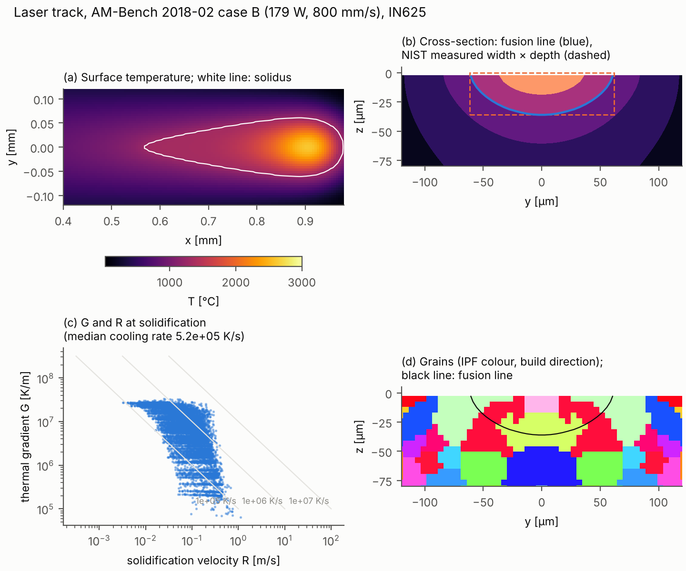
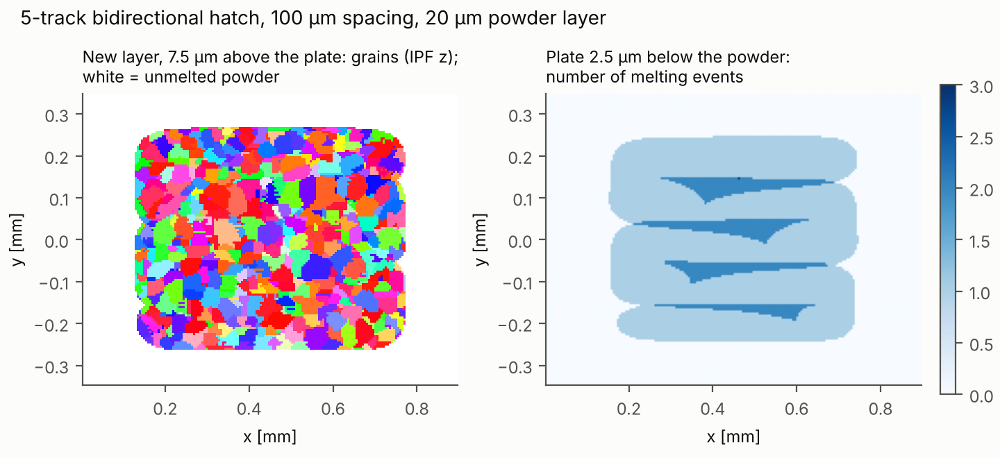
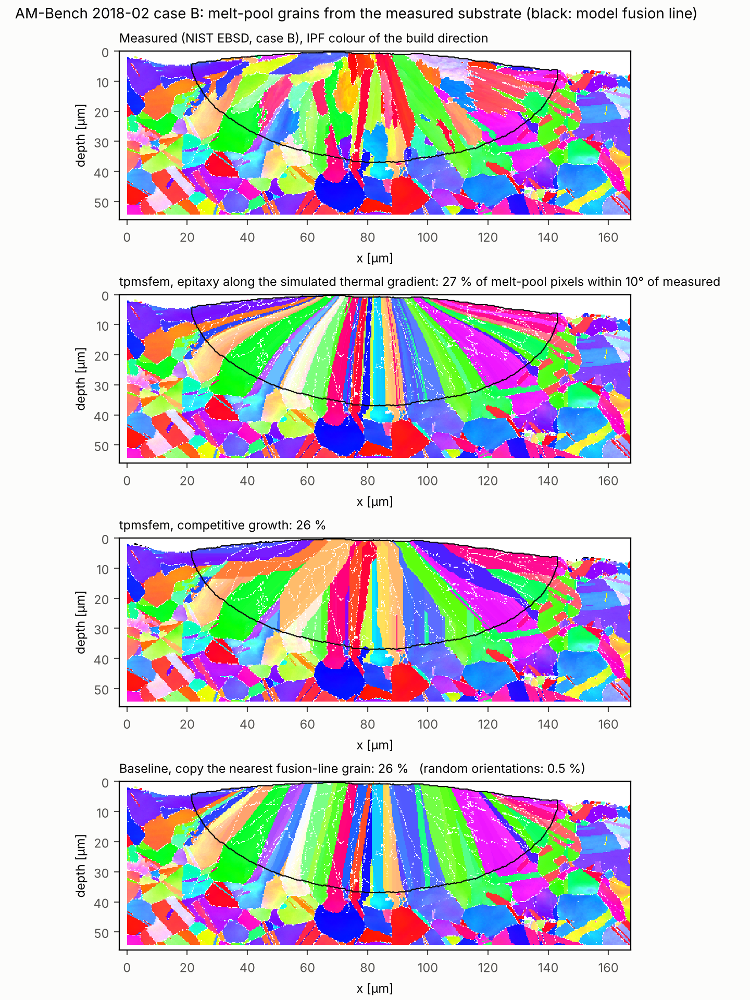
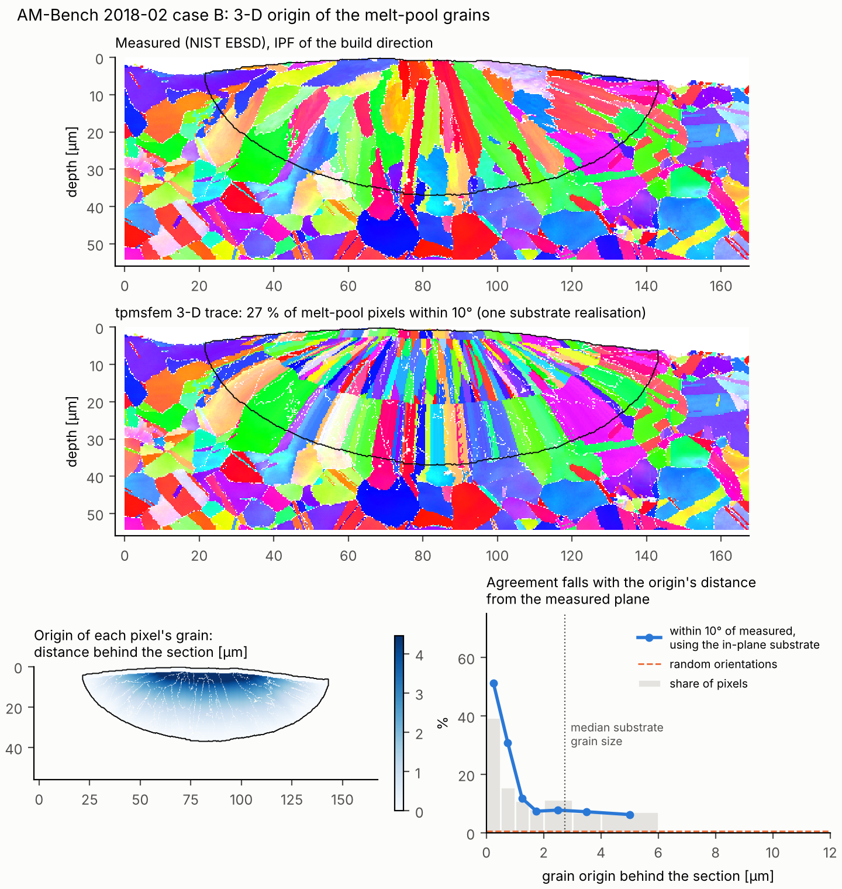
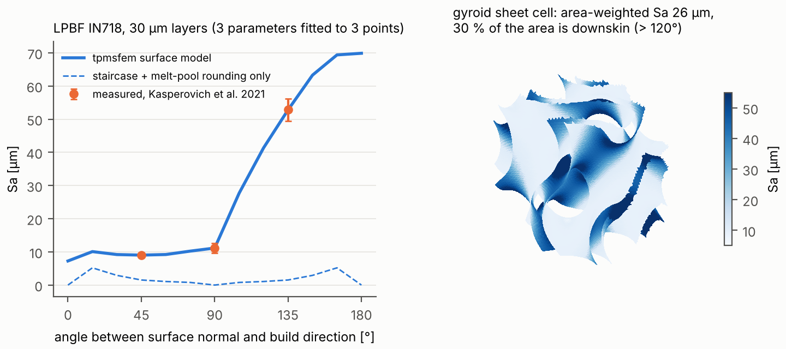

# Process-scale models: laser scan, melt pool, solidification, surface roughness

`tpmsfem.process` adds melt-pool-scale models of laser powder-bed fusion to the part-scale
thermo-mechanical AM model. They form one chain:

    scan path + laser  ->  melt pool (meltpool.py)  ->  G, R, cooling rate, melting times
                                         |                        |
                                         v                        v
                         bead size -> surface roughness   solidification microstructure
                                     (roughness.py)       (solidification.py, ExaCA export)

Everything runs on the NumPy/CuPy backend, so the same code is GPU-ready. The figures and
numbers below come from a 4-core CPU.

## 1. Melt pool (`process/meltpool.py`)

**Physics.** An explicit finite-volume enthalpy method on a structured voxel grid,
`dH/dt = div(k grad T) + q_laser - q_surface`. It includes:

* **Enthalpy.** Sensible and latent heat (solidus to liquidus), inverted to `T` by table
  look-up, so energy is conserved to round-off (tested to 1e-14).
* **Conductivity.** `k(T)` at faces as a harmonic mean, plus an optional anisotropic
  enhancement factor in the liquid. This is the standard conduction-model stand-in for
  Marangoni convection, which is not resolved.
* **Powder.** A powder layer with reduced conductivity, densified when it melts.
* **Laser.** A Gaussian (or top-hat) surface source of absorbed power `A·P`, normalised exactly
  on the grid. An optional absorption depth spreads it into the material.
* **Scan paths.** Scan vectors and raster hatching with jumps.
* **Surface losses.** Radiation, convection, and evaporation (Clausius–Clapeyron vapour
  pressure with a Hertz–Knudsen–Langmuir mass flux and back-condensation). Evaporation caps
  the surface temperature near boiling, at about 3000 to 3500 °C here.
* **Symmetry.** A symmetry plane under a single track halves the cost.
* **Recorded per cell.** Peak temperature, number of melting events, last melting and
  solidification times, and, at solidification, cooling rate, `G = |grad T|`, its direction
  and `R = cooling rate / G`. Probes record surface histories, as a thermal camera does.

**Verification.**
* **Exact solution.** A moving Gaussian source on a semi-infinite body, the Eagar–Tsai
  integral, with constant properties. With 10 µm cells the solver agrees within 1 % at all
  checked points. The analytic routine itself reproduces Rosenthal's point-source solution
  to 6 digits.
* **Energy balance.** With latent heat and surface losses, the enthalpy balance closes to
  1e-9 or better.

**Validation, NIST AM-Bench 2018-02** (single tracks on bare IN625, NIST AMMT testbed): see §4.

## 2. Solidification microstructure (`process/solidification.py`)

* **G–R map.** Thermal gradient and solidification velocity at the last liquidus crossing of
  every melted cell, the cooling rate `G·R`, and the morphology indicator `G/R`.
* **Cell and dendrite spacing.** Kurz–Fisher (`4.3 (ΔT0 D Γ / k)^¼ G^-½ R^-¼`), Hunt, or a
  user-fitted cooling-rate law.
* **Columnar-to-equiaxed transition.** Hunt's (1984) criterion with a tip-undercooling growth
  law.
* **Grains.** A reduced cellular-automaton model of epitaxial, competitive columnar growth.
  * Melted cells re-solidify in time order.
  * Each one takes the grain of an already solid neighbour. The choice is weighted by how
    well that grain's nearest <100> axis aligns with the local growth direction (grad T at
    solidification), so well-oriented grains crowd out the others.
  * Equiaxed grains nucleate where Hunt predicts equiaxed growth.
  * Outputs: grain maps, inverse-pole-figure colours and texture fractions.
* **ExaCA export.** `x,y,z,tm,tl,cr` CSV (SI units) for ORNL's open-source GPU
  cellular-automaton code. Use it when the full decentred-octahedron kinetics matter.

**Constants.** The alloy constants (Gibbs–Thomson, diffusivity, partition coefficient,
nucleation density, growth law) are inputs. The defaults are generic Ni–Nb values and are
**not calibrated for IN625**.

## 3. Surface roughness (`process/roughness.py`)

The as-built topography of a surface tilted by θ from the build direction is the
superposition of three parts:
* **Layer staircase.** Peak-to-valley `t |cos θ|`, so `Ra = t |cos θ|/4` for sharp steps.
* **Melt-pool rounding.** Morphological closing with the bead radius, taken from the
  melt-pool model.
* **Partially fused powder.** Spheres from the powder size distribution, stuck on as a
  Poisson process. Their density rises on down-facing surfaces and falls on up-facing ones.

Roughness parameters follow ISO 4287 and 25178 (Ra, Rq, Rz; Sa, Sq, Sz). `roughness_map` puts
the model onto any triangulated surface (for example a TPMS implant) by facet inclination.

**Validation, Kasperovich et al. 2021** (LPBF IN718, 30 µm layers): see §5.

## 4. AM-Bench 2018-02 single tracks (melt pool)

NIST laser tracks on bare IN625 plate, AMMT testbed: 1070 nm, D4σ = 170 µm (Gaussian 1/e²
radius 85 µm), true powers 137.9 / 179.2 / 179.2 W. Measurements are from the
[AMB2018-02 description](https://www.nist.gov/ambench/amb2018-02-description) and its
melt-pool-length, cross-section and cooling-rate result pages.

**Model set-up.**
* 5 µm cells, half-symmetric domain 1.9 × 0.3 × 0.2 mm, 1.5 mm track.
* Evaporation on. The liquid is not enhanced: enhancing it in depth would have needed a
  factor of about 7.

**Calibration on case B**, NIST's calibration case. Two parameters are fitted to its width
and depth:
* absorptivity A = 0.323;
* absorption depth δ = 15.3 µm (exponential), the usual effective treatment of the shallow
  vapour depression at about 1.6 MW/cm² peak intensity.

Without δ, absorptivity alone (0.206) matches the width but gives only 22 µm depth. Cases A
and C are predictions:

| case | P, v | quantity | measured (NIST AMMT) | tpmsfem | diff |
|---|---|---|---:|---:|---:|
| A (prediction) | 137.9 W, 400 mm/s | melt-pool width | 147.9 ± 3.7 µm | 141.7 µm | −4 % |
| A (prediction) | 137.9 W, 400 mm/s | melt-pool depth | 42.5 ± 1.7 µm | 47.2 µm | +11 % |
| A (prediction) | 137.9 W, 400 mm/s | melt-pool length (solidus) | 300 ± 12 µm | 357 µm | +19 % |
| B (calibration) | 179.2 W, 800 mm/s | width / depth (fitted) | 123.5 / 36.0 µm | 123.3 / 36.0 µm | 0 % |
| B (calibration) | 179.2 W, 800 mm/s | melt-pool length (solidus) | 359 ± 20 µm | 414 µm | +15 % |
| C (prediction) | 179.2 W, 1200 mm/s | melt-pool width | 106.0 ± 1.4 µm | 100.9 µm | −5 % |
| C (prediction) | 179.2 W, 1200 mm/s | melt-pool depth | 29.6 ± 0.6 µm | 24.7 µm | −17 % |
| C (prediction) | 179.2 W, 1200 mm/s | melt-pool length (solidus) | 370 ± 10 µm | 344 µm | −7 % |
| A / B / C | | surface cooling rate 1290→1190 °C | 1.2 / 1.1 / 1.9 ×10⁶ K/s | 3.3 / 5.9 / 8.9 ×10⁶ K/s | 3–5× too high |

**Reading the results.**
* **Widths** are predicted within 5 %.
* **Depths** are within −17 % to +11 %, but the speed trend is too steep: too deep at
  400 mm/s, too shallow at 1200 mm/s. One fixed absorption depth cannot follow a vapour
  depression that deepens at low speed. A speed- or intensity-dependent δ, or a
  free-surface model, would.
* **Lengths** are within −7 % to +19 %. The two NIST machines differ by about 2× in measured
  length (CBM 659–782 µm), and NIST left the cause open.
* **Cooling rates** are 3–5× higher than NIST's thermography. The camera's spatial and
  temporal resolution and the emissivity assumption smear the steep solidification-front
  gradient, which likely contributes. NIST also reports that the two machines' cooling rates
  "differ drastically". The model, however, also omits fluid flow in the melt pool, which reshapes the temperature
  field near the solidification front. The predicted rates are therefore not validated.
* **Cost.** One case-B run takes 2.5 minutes on 4 CPU cores (2,528 explicit steps, 0.96 M cells).

## 5. Solidification and grains (track B)

`examples/05_lpbf_meltpool_microstructure.py` (summary in `results/process/summary.json`):

| quantity (re-solidified cells of track B, 5–50–95th percentiles) | value |
|---|---|
| thermal gradient G | 5.1e+05 / 7.3e+06 / 2.5e+07 K/m |
| solidification velocity R | 0.017 / 0.086 / 0.28 m/s (scan speed 0.8 m/s) |
| cooling rate G·R at the liquidus | 7.5e+04 / 5.2e+05 / 1.6e+06 K/s |
| primary spacing, Kurz–Fisher (generic constants) | 1.16 / 1.82 / 5.89 µm |
| Hunt CET (CMSX-4 constants): columnar / mixed / equiaxed | 43 / 36 / 22 % of the fusion zone |
| grains in the fusion zone (30 µm substrate grains, purely epitaxial) | 110; <100> within 15° of the build direction in 16 % of the volume (random: about 10 %) |
| ExaCA export | 18,296 cells (`results/process/exaca_track_B.csv`) |
| 5-track hatch on 20 µm powder | up to 3 melting events per cell; 638 grains in the fused region |

* **Cooling at the liquidus.** The cooling rate at the liquidus crossing is about 10× lower
  than the surface rate between 1290 and 1190 °C: latent heat slows cooling in the mushy zone.
* **Texture.** Competitive growth gives a mild <100> texture along the build direction.
* **First layer.** The grains of the first layer are inherited epitaxially from the plate.

### 5.1 Grains against NIST's EBSD map (case B)

**Data.** NIST's example EBSD map of a case-B track: a transverse cross-section, Oxford
`.ctf` with 1218 × 890 points at 0.14 µm
([AMB2018-02_CaseB_EBSDdata.zip](https://s3.amazonaws.com/nist-midas/1889/AMB2018-02_CaseB_EBSDdata.zip)).
It is analysed with `tpmsfem.process.ebsd`: CTF reader, Bunge orientations, cubic
disorientation, grain segmentation at 10° and kernel misorientation. The script is
`benchmarks/literature/nist_ambench2018_tracks_ebsd.py`.

**Test.** The melt pool grows epitaxially from the plate's grains, so the measured
substrate fixes the initial condition. The measured orientations *inside* the model's fusion
line are hidden and regrown from the substrate:
* in the order of the simulated solidification times;
* along the simulated growth direction (grad T at solidification) of the steady-state
  case-B section;
* on the 0.28 µm EBSD grid (2 × 2 binning).

The prediction is compared with the measurement pixel by pixel.

**Placement.** The fusion line is the calibrated model's, which matches NIST's case-B mean
size. Its centre is put where the elongated grains change their lean (x = 82.4 µm). Depth is
measured from the local surface.

| regrowth of the melt pool (3116 µm², 39,749 px) | pixels within 10° of measured | grains (10°) | area-weighted grain size |
|---|---:|---:|---:|
| measured | — | 92 | 10.1 µm |
| tpmsfem, epitaxy along the simulated thermal gradient (trace back to the substrate) | **27.5 %** | 83 | 12.3 µm |
| tpmsfem, upstream-neighbour rule (`grow_grains(rule="upstream")`) | 26.6 % | 50 | 13.1 µm |
| tpmsfem, competitive growth (`grow_grains`, default) | 26.4 % | 45 | 14.5 µm |
| tpmsfem, dendrite-arm capture rule | 21.0 % | 42 | 14.5 µm |
| baseline: copy the nearest fusion-line grain | 25.8 % | 51 | 13.0 µm |
| baseline: copy the grain straight below | 19.8 % | — | — |
| random orientations | 0.5 % | — | — |

**Reading the results.**
* **The fan of columnar grains comes from epitaxy.** It converges toward the top centre, and
  so does the simulated one. About a quarter of the melt pool, point by point, is the plate
  grain directly below or beside it, extended along the thermal gradient.
* **The gradient direction helps a little.** Following the simulated gradient is slightly
  better than following the fusion-line normal (27.5 % vs 25.8 %), and it reproduces the
  grain count: 83 against 92 measured.
* **Competition adds nothing here.** Selecting grains by <100> alignment does not improve
  point-wise agreement over this short, 36 µm growth distance. It merges grains (45 against
  92). An earlier, slightly smaller fusion-zone definition gave the competitive rule a texture
  match (9.6 % against 10.9 % <100> within 15° of the build direction). That match vanished
  with the smoother definition, so it is not claimed.
* **The fusion line checks out independently.** The model's fusion line follows the
  measured boundary between columnar and equiaxed grains.
* **The test has a ceiling.**
  * It is a 2-D test: grains can enter the section from substrate above or below the plane.
  * The fusion line is the model's, not a measured one.
  * The unmelted plate is fine-grained (median equivalent diameter 4.2 µm, many annealing
    twins).
  * The model resolves the thermal field at 5 µm.

### 5.2 3-D test: where the section's grains come from

**What the 2-D test assumed.** In a moving melt pool the growth direction also points
forward along the scan, so a grain seen in the transverse section may have started on the
fusion boundary *behind* it. The 2-D regrowth assumed every grain started in the measured
plane.

**Method.** `benchmarks/literature/nist_ambench2018_tracks_ebsd3d.py` traces each melt-pool
pixel of the section backwards through the simulated **3-D** steady-state growth-direction
field of case B, until it leaves the melt pool. That point is where its grain started.

**Origins.** All 39,749 traces reach the fusion boundary, after a median path of
11 µm.
* **Distance behind the section.** The median origin lies 0.8 µm behind
  the section, the 90th percentile 3.6 µm.
* **Where.** Grains near the top centre start furthest back; along the sides and bottom they
  start in the plane.
* **In-plane share.** 64 % of the pixels have an origin within
  ±1.4 µm of the plane, half the measured median substrate grain size of
  2.7 µm.

**Parameter-free check.** Give every pixel the measured in-plane substrate orientation at its
origin's (y, z), then bin the agreement by the origin's distance from the plane:

| origin behind the section | share of melt-pool pixels | within 10° of measured |
|---|---:|---:|
| 0–0.5 µm | 39.5 % | 51.2 % |
| 0.5–1 µm | 15.6 % | 30.8 % |
| 1–1.5 µm | 11.1 % | 11.8 % |
| 1.5–2 µm | 8.3 % | 7.4 % |
| 2–3 µm | 11.3 % | 7.8 % |
| 3–4 µm | 6.9 % | 7.2 % |
| 4–6 µm | 7.2 % | 6.3 % |
| random orientations | | 0.6 % |

* **Agreement follows the origin's distance.** Half of the pixels whose grains start within
  0.5 µm of the measured plane are predicted correctly. Agreement falls to a residual 6–8 %
  once the origin lies 1.5 µm or more behind it. The residual exceeds random because large
  substrate grains reach a few µm out of the plane.
* **The prediction is confirmed.** The point-wise failures of the 2-D test are explained by
  grains from substrate NIST did not measure, and their share is predicted by the 3-D thermal
  field.

**Hybrid prediction.** Use the measured orientations for in-plane origins, and a
statistically equivalent 3-D substrate elsewhere: Voronoi grains whose orientations are drawn
from the measured substrate, 5 realisations.
* **All pixels:** 26.7 ± 0.6 % within 10°.
* **In-plane origins:** 41 %.
* **Upstream origins:** 1.5 %, close to random.
* **Ceiling.** The 2-D result (27.5 %) is close to the best that can be expected from a single
  section. Doing better needs the substrate in 3-D, for example from serial sections.

**Grain count.** The hybrid predicts 236 grains in the section with
2.7 µm stand-in substrate grains, against
92 measured. With the area-weighted size
(7.9 µm) it predicts 121. The
unmeasured 3-D substrate grain size sets the count of the upstream-origin grains.

The remaining NIST track files (SEM and EBSD maps of tracks 3, 5 and 10, the 10 optical
cross-sections of mds2-3830) did not download: they returned server errors, HTTP 500, on
2026-11-07.

## 6. Roughness vs build angle (Kasperovich et al. 2021, LPBF IN718)

Kasperovich, Becker, Artzt et al., *Materials & Design* 207 (2021) 109858,
doi:10.1016/j.matdes.2021.109858 (gold open access).
* **Build.** Concept Laser M2, 30 µm layers, powder D10/D50/D90 = 22/33/45 µm.
* **Measurement.** Sa by laser scanning microscopy on 2.44 × 2.44 mm² of flat outer surfaces
  at 45° (upskin), 90° (vertical) and 135° (downskin).
* **Model inputs.** The edge radius is half the width of the contour track (180 W,
  1600 mm/s) from the calibrated melt-pool model: 85 µm wide, so 43 µm.
* **Fit.** The three particle parameters are fitted to the three measured Sa values. This is
  a calibrated description, not a prediction.

| contour | measured Sa 45° / 90° / 135° | fitted model | particles on a vertical wall | downskin / upskin factors |
|---|---|---|---:|---:|
| 180 W, 1600 mm/s (E_L 0.113 J/mm) | 9.01 ± 0.33 / 11.17 ± 1.44 / 52.80 ± 3.41 µm | 9.02 / 11.16 / 52.80 µm | 268 /mm² | k_down 4.3, k_up 0.33 |
| optimum, E_L 0.18 J/mm | 6.8 / 7.2 / 47.5 µm | 6.79 / 7.22 / 47.21 µm | 179 /mm² | 6.2, 0.18 |

**Reading the results.**
* **Parts of the roughness.** The layer staircase and melt-pool rounding alone give only
  0–5 µm. Powder stuck to the surface dominates, especially on down-facing surfaces, which
  rest on the powder bed.
* **TPMS application.** On a 3 mm, 30 %-dense gyroid sheet cell, 30 % of the area faces
  down by more than 120°. The area-weighted Sa is therefore 26 µm, against 11 µm for a
  vertical wall.
* **Why it matters.** For lattice implants this roughness is
  * a fatigue concern (notches),
  * a fluid-flow and osseointegration factor,
  * and a reason the as-built stiffness of thin sheets falls below the CAD value.
